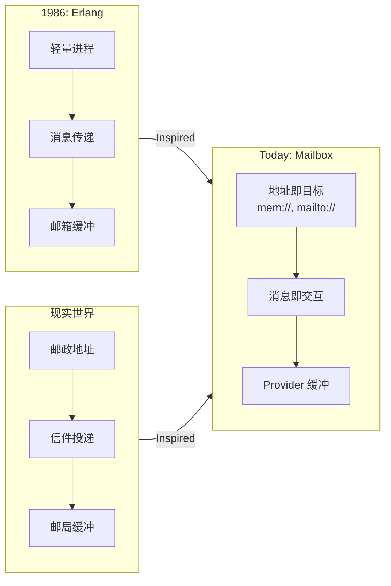

# 📮 Mailbox — 重新思考异步编程

> 轻量可插拔的“邮箱/队列”内核，把一切通信看作“给某个地址投递一封信”。一个地址代表一个唯一的邮箱，它可以通过不同的 Provider 适配的多种传输协议（如 `mem:`、`mailto:`、`slack:`）来访问。
> 用邮箱（Mailbox）进行异步通讯，构建容错、分布式、人机协同系统。

[](https://www.npmjs.com/package/@mboxlabs/mailbox)
[](LICENSE)

## 🌟 为什么 Mailbox？

| 传统方式 | Mailbox 方式 |
|----------|--------------|
| ❌ 共享状态 + 锁 | ✅ 独立邮箱 + 消息 |
| ❌ 回调地狱 | ✅ `async/await` 无缝衔接 |
| ❌ 人机协作复杂 | ✅ 人 = 一个邮箱地址 |
| ❌ 离线场景难处理 | ✅ 消息自动缓冲重试 |

### Erlang 灵感

> _🙏 致敬：Erlang 的 Actor 模型_
> _“在 1980 年代，当计算机还像房间一样大时，
> Erlang 的创造者们就提出了一个革命性思想：
> **每个进程有自己的邮箱，通过消息通信，崩溃不是失败而是设计的一部分**”_
> —— Joe Armstrong, Robert Virding, Mike Williams

Mailbox **深受 Erlang Actor 模型启发**，但我们做了关键演进：

| Erlang (1986) | Mailbox (Today) | 为什么重要 |
|---------------|-----------------|------------|
| `Pid ! Message` | `send({ to: 'protocol://address' })` | **地址即身份，协议即路由**：`address` 部分是邮箱的唯一 ID。`protocol`（例如 `mem`, `mailto`）决定路由方式。同一地址可通过不同协议访问。 |
| 进程内 FIFO 邮箱 | Provider 可插拔 | **传输无关**：内存/邮件/Wechat/Mastodon 无缝切换 |
| 同一节点内通信 | 跨网络、跨组织 | **真正分布式**：人类和机器平等参与 |

> 💡 **我们的定位**：
> **不是 Erlang 的 JavaScript 复刻，而是 Actor 思想的现代化表达** ——
> 用 TypeScript 的类型安全 + JavaScript 的生态活力，让“地址即目标”触手可及。

## 🚀 为什么 Mailbox 让人激动？

### 📮 我们解决了什么？

| 传统世界 | Mailbox 世界 |
|----------|--------------|
| ❌ “服务必须在线才能调用” | ✅ **投递即成功** —— 不关心对方状态 |
| ❌ “人类必须实时响应” | ✅ **人类 = 一个地址** —— 按自己节奏处理 |
| ❌ “跨组织协作需要 API 对接” | ✅ **电子邮件就是 API** —— 零集成成本 |
| ❌ “移动端离线 = 功能瘫痪” | ✅ **离线是常态** —— 消息自动缓冲等待 |

### 💡 灵感融合：Erlang 智慧 + 现实世界

> _“Erlang 教会我们：**消息传递是构建健壮系统的基石**
> 现实世界提醒我们：**邮政系统运转 500 年，因为它不假设收件人此刻在家门口等待！**”_

Mailbox 将二者结合：

- **Actor 的严谨**：每个目标独立邮箱，消息是唯一通信方式
- **邮政的包容**：地址统一标识，传输协议可插拔



## 📪 邮箱地址

邮箱地址（**MailAddress**）是整个系统的基石，作为任何目的地的唯一通用标识符。它遵循 [RFC 3986](https://tools.ietf.org/html/rfc3986) URI 规范。

- **格式**: `protocol:user@physical_address[/logical_address]`
- **示例**: `mailto:api@myservice.com/utils/greeter`

一个邮箱地址由三部分组成：

- **`protocol`（协议）**: 指定消息的**传输方式**（例如 `mailto` 代表通过邮件发送，`mem` 代表通过内存总线发送）。它告诉 `Mailbox` 应该由哪个提供者处理消息。
- **`user@physical_address`（物理邮箱地址）**: 这是逻辑邮箱或服务的**全球唯一、与协议无关的 ID**。同一个物理地址可以通过不同的协议访问（例如 `mem:api@myservice.com` 和 `mailto:api@myservice.com` 指向同一个逻辑实体）。
- **`/logical_address`（逻辑地址）** (可选): 一个可选的路径，可用于内部路由。例如，当与 `tool-rpc` 结合使用时，它可以将消息路由到更庞大服务中的特定工具，允许一个物理地址作为多个逻辑功能的统一网关。
  - 注意：不是所有的提供者都支持。

## 🚀 快速开始

只需三步，即可体验 Mailbox 的核心魅力：

1. **安装**

   ```bash
   npm install @mboxlabs/mailbox
   ```

2. **编写代码**

   ```ts
   import { Mailbox, MemoryProvider } from '@mboxlabs/mailbox';

   // 1. 创建 Mailbox 实例并注册内存 Provider
   const mailbox = new Mailbox();
   mailbox.registerProvider(new MemoryProvider());

   // 2. 启动 Mailbox (初始化 Provider)
   await mailbox.start();

   // 3. 订阅一个地址并定义消息处理方式
   const subscription = mailbox.subscribe('mem:service@example.com/inbox', message => {
     console.log(`收到消息！来自: ${message.from}`);
     console.log(`正文:`, message.body);
   });

   console.log("Mailbox 已就绪，正在监听 'mem:service@example.com/inbox'...");

   // 4. 发送一封邮件到该地址
   await mailbox.post({
     from: 'mem:client@example.com/user-1',
     to: 'mem:service@example.com/inbox',
     body: { text: 'Hello, Mailbox!' },
   });

   // 清理：取消订阅并停止 Mailbox (释放资源)
   await subscription.unsubscribe();
   await mailbox.stop();
   ```

   1. **运行**

   如果你使用 `ts-node` 或类似工具运行上述代码，你将看到：

   ```sh
   Mailbox 已就绪，正在监听 'mem:service@example.com/inbox'...
   收到消息！来自: mem:client@example.com/user-1
   正文: { text: 'Hello, Mailbox!' }
   ```

   该示例演示了 Mailbox 的基本闭环：**初始化 -> 启动 -> 订阅 -> 发送 -> 停止**。

   ## 🎯 核心功能

   ### 1. 状态查询

   ```ts
   const status = await mailbox.status('mem:service@example.com/inbox');
   console.log(`状态: ${status.state}`);
   console.log(`未读数量: ${status.unreadCount}`);   // 仍在队列里等待
   console.log(`in-flight: ${status.inFlightCount}`); // 已取出、尚未 ack/nack
   console.log(`订阅数: ${status.subscriberCount}`);
   ```

   `unreadCount` 只统计队列里等待的消息。用 `manualAck: true` 取出的消息已经离开队列但尚未
   处理完，它单独计入 `inFlightCount`；如果一直不 ack，会回到队列。

   ### 2. 取消息的两种方式：订阅与取回

   三个动作对应三个 API，文档与代码里统一用这三个词：

   | 动作 | API | 谁在做 |
   | --- | --- | --- |
   | **发布** | `post()` / `send()` | 生产者把一封信写进地址 |
   | **订阅** | `subscribe()` | 消费者登记回调，消息到达时被调用 |
   | **取回** | `fetch()` | 消费者自己主动取下一条 |

   发布只是写入。一条消息只会进两个入口的**其中一个**，在 `post()` 执行那一刻定：

   | `post()` 执行时地址的状态 | 消息的去向 |
   | --- | --- |
   | 至少有一个活跃订阅者 | 交给每个订阅者的回调；**不**入队，所以 `fetch()` 取不到 |
   | 没有任何订阅者 | 入队；`fetch()` 能取到，订阅者收不到 |

   两条路对同一条消息是互斥的：已经订阅到的消息再也取回不到；已经入队的消息也不会回放给
   后来才订阅的人。

   两条路都走会让 `unreadCount` 永远增长（订阅者从不取回），还会在退订后把已处理过的消息
   再交给下一个取回者。

   唯一的例外是回调失败：回调抛可重试错误时消息会回到队列，这时 `fetch()` 能取到——见下一节。

   ```ts
   // subscribe：消息到达时跑回调
   const sub = mailbox.subscribe(addr, (message) => {
     console.log(message.body);
   });

   // fetch：自己主动取下一条
   const message = await mailbox.fetch(addr);
   ```

   ### 3. 订阅失败时

   回调抛出的错误决定消息的去向：

   ```ts
   mailbox.subscribe(addr, async (message) => {
     throw Object.assign(new Error('upstream down'), { isRetriable: true }); // → 回到队列
   });

   mailbox.subscribe(addr, async (message) => {
     throw new Error('bad payload'); // → 丢弃，避免一条坏消息被无限重试
   });
   ```

   可重试指 `error.isRetriable === true`，或 `error.code` 属于 `503 / 504 / ECONNRESET /
   ETIMEDOUT`。可重试失败会把消息退回队列（计入 `unreadCount`，可用 `fetch()` 取回）；其余直接
   丢弃。Python 与 Rust 两个移植版行为一致——Rust 端回调返回 `Result<()>`，由
   `MailboxError::is_retriable()` 做同样的判定。

   ### 4. 订阅重试（opt-in）

   默认行为下，可重试失败只是把消息退回队列：没有任何东西会再次调用订阅回调，后续怎么办由
   `fetch()` 消费者决定。想让库自己重投，就显式开启重试：

   ```ts
   import { MemoryProvider } from '@mboxlabs/mailbox';

   const provider = new MemoryProvider({ maxAttempts: 3, baseDelay: 1_000 }); // 毫秒
   mailbox.registerProvider(provider);
   ```

   | | 默认（不传 `retry`） | 传入策略 |
   |---|---|---|
   | 可重试失败 | 回队一次，由 `fetch()` 取回 | 按指数退避重新调用回调 |
   | 尝试次数 | 1 | `maxAttempts`（含首次） |
   | 次数耗尽 | — | 消息退回队列，由 `fetch()` 取回 |

   两条规则保证它不会造成重复投递：

   - **只重投给失败的那个订阅者。** 订阅是广播；重新广播会让已经成功的订阅者把副作用再跑
     一次。
   - **同一条消息不会在队列里出现两份。** `requeue()` 遇到已在队列或已在 in-flight 的消息就
     跳过，因此 N 个订阅者各自失败也只留一份副本。

   重试是 opt-in 的，因为 AMQP / SQS 这类传输本身就会重投、还自带死信队列，库再重投就是双重
   投递；自己负责投递的 provider 应当保持关闭。`provider.setRetryPolicy(null)` 回到默认行为，
   子类可以用 `_onRetryExhausted` 钩子做死信落库或告警。

   Python 端是 `RetryPolicy(max_attempts=3, base_delay=1.0)`（单位：秒），Rust 端是
   `MemoryProvider::with_retry(Some(RetryPolicy::new(3, Duration::from_millis(1000))))`。

   策略本身也是导出的：`RetryPolicy`、`isRetriableError`、`nextRetryDelay`、`AttemptLedger`——
   其他包（比如 RPC 传输层）可以直接复用同一套「可重试判定 + 退避」，不必各写一份。

   ### 5. ACK 超时

   `fetch(address, { manualAck: true })` 会把消息置为 in-flight。没有超时的话，崩溃的消费者会
   永久泄漏这条消息，因此未 ack 的消息默认在 `DEFAULT_ACK_TIMEOUT`（30 秒）后重新入队：

   ```ts
   import { DEFAULT_ACK_TIMEOUT } from '@mboxlabs/mailbox';

   await mailbox.fetch(addr, { manualAck: true });                    // 默认 30 秒
   await mailbox.fetch(addr, { manualAck: true, ackTimeout: 5_000 }); // 自定义
   await mailbox.fetch(addr, { manualAck: true, ackTimeout: 0 });     // 永不重投
   ```

   Python（`ack_timeout`，`0` = 永不重投）与 Rust（`ack_timeout: Option<Duration>`，
   `Some(Duration::ZERO)` = 永不重投）两个移植版保持同样的三态语义。

   ### 6. 访问 Provider

   你可以通过 `providers` Getter 或 `getProvider` 方法优雅地访问已注册的 Provider：

   ```ts
   // 获取所有 Provider (返回一个 ReadonlyMap)
   const allProviders = mailbox.providers;
   if (allProviders.has('mem')) {
     console.log('内存 Provider 已注册');
   }

   // 获取特定 Provider
   // protocol 可以是 "mem" 或 "mem:"
   const provider = mailbox.getProvider('mem');

   // 获取 Provider，如果不存在则抛出错误
   const slackProvider = mailbox.getProvider('slack', true);
   ```

   ## 🔄 生命周期管理

   对于健壮的生产系统，显式的生命周期管理至关重要：

   - **`mailbox.start()`**: 并行初始化所有已注册的 Provider。使用它来预热连接（如 Redis、RabbitMQ）并在处理流量前验证配置。
   - **`mailbox.stop()`**: 并行关闭所有 Provider。它会自动执行以下操作：
   - 取消该 Mailbox 实例下所有活跃的订阅。
   - 释放底层资源（TCP 连接、文件句柄等）。
   - 确保通信层的优雅关闭（Graceful Shutdown）。

   ## 📦 生态系统

| 包 | 说明  |
|-----|------|
| [`@mboxlabs/mailbox`](https://github.com/mboxlabs/mailbox.js) | 核心邮箱系统 |
| [`@mboxlabs/mailbox-input`](https://github.com/mboxlabs/mailbox-input.js) | 输入提供者：人机输入交互抽象类 |
| [`@mboxlabs/mailbox-email`](https://github.com/mboxlabs/mailbox-email.js) | 邮箱提供者：电子邮件(SMTP, IMAP/POP3),待实现 |

## 📚 深入学习

- [Erlang 灵感详解](erlang-inspiration.md)
- [5 个真实场景示例](examples.md)
- [API 速查手册](docs/)

## 🤝 贡献指南

详见 [CONTRIBUTING.cn.md](CONTRIBUTING.cn.md) —— 我们欢迎所有贡献者！

> **记住**：在 Mailbox 的世界里，**每个邮箱都是一个独立宇宙，消息是穿越时空的信使** 🌌
