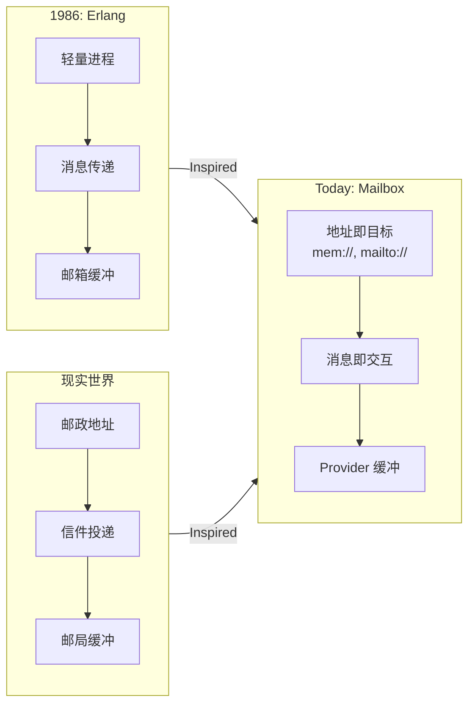

# 📮 Mailbox — 重新思考异步编程

> 轻量可插拔的“邮箱/队列”内核，把一切通信看作“给某个地址投递一封信”。一个地址代表一个唯一的邮箱，它可以通过不同的 Provider 适配的多种传输协议（如 `mem:`、`mailto:`、`slack:`）来访问。
> 用邮箱（Mailbox）进行异步通讯，构建容错、分布式、人机协同系统。

[](https://www.npmjs.com/package/@mboxlabs/mailbox)
[](LICENSE)

## 🌟 为什么 Mailbox？

| 传统方式          | Mailbox 方式              |
| ----------------- | ------------------------- |
| ❌ 共享状态 + 锁  | ✅ 独立邮箱 + 消息        |
| ❌ 回调地狱       | ✅ `async/await` 无缝衔接 |
| ❌ 人机协作复杂   | ✅ 人 = 一个邮箱地址      |
| ❌ 离线场景难处理 | ✅ 消息自动缓冲重试       |

### Erlang 灵感

> _🙏 致敬：Erlang 的 Actor 模型_
> _“在 1980 年代，当计算机还像房间一样大时，
> Erlang 的创造者们就提出了一个革命性思想：
> **每个进程有自己的邮箱，通过消息通信，崩溃不是失败而是设计的一部分**”_
> —— Joe Armstrong, Robert Virding, Mike Williams

Mailbox **深受 Erlang Actor 模型启发**，但我们做了关键演进：

| Erlang (1986)    | Mailbox (Today)                      | 为什么重要                                                                                                                              |
| ---------------- | ------------------------------------ | --------------------------------------------------------------------------------------------------------------------------------------- |
| `Pid ! Message`  | `send({ to: 'protocol://address' })` | **地址即身份，协议即路由**：`address` 部分是邮箱的唯一 ID。`protocol`（例如 `mem`, `mailto`）决定路由方式。同一地址可通过不同协议访问。 |
| 进程内 FIFO 邮箱 | Provider 可插拔                      | **传输无关**：内存/邮件/Wechat/Mastodon 无缝切换                                                                                        |
| 同一节点内通信   | 跨网络、跨组织                       | **真正分布式**：人类和机器平等参与                                                                                                      |

> 💡 **我们的定位**：
> **不是 Erlang 的 JavaScript 复刻，而是 Actor 思想的现代化表达** ——
> 用 TypeScript 的类型安全 + JavaScript 的生态活力，让“地址即目标”触手可及。

## 🚀 为什么 Mailbox 让人激动？

### 📮 我们解决了什么？

| 传统世界                     | Mailbox 世界                             |
| ---------------------------- | ---------------------------------------- |
| ❌ “服务必须在线才能调用”    | ✅ **投递即成功** —— 不关心对方状态      |
| ❌ “人类必须实时响应”        | ✅ **人类 = 一个地址** —— 按自己节奏处理 |
| ❌ “跨组织协作需要 API 对接” | ✅ **电子邮件就是 API** —— 零集成成本    |
| ❌ “移动端离线 = 功能瘫痪”   | ✅ **离线是常态** —— 消息自动缓冲等待    |

### 💡 灵感融合：Erlang 智慧 + 现实世界

> _“Erlang 教会我们：**消息传递是构建健壮系统的基石**
> 现实世界提醒我们：**邮政系统运转 500 年，因为它不假设收件人此刻在家门口等待！**”_

Mailbox 将二者结合：

- **Actor 的严谨**：每个目标独立邮箱，消息是唯一通信方式
- **邮政的包容**：地址统一标识，传输协议可插拔



## 📪 邮箱地址

邮箱地址（**MailAddress**）是整个系统的基石，作为任何目的地的唯一通用标识符。它遵循 [RFC 3986](https://tools.ietf.org/html/rfc3986) URI 规范。

- **格式**: `protocol:user@physical_address[/logical_address]`
- **示例**: `mailto:api@myservice.com/utils/greeter`

一个邮箱地址由三部分组成：

- **`protocol`（协议）**: 指定消息的**传输方式**（例如 `mailto` 代表通过邮件发送，`mem` 代表通过内存总线发送）。它告诉 `Mailbox` 应该由哪个提供者处理消息。
- **`user@physical_address`（物理邮箱地址）**: 这是逻辑邮箱或服务的**全球唯一、与协议无关的 ID**。同一个物理地址可以通过不同的协议访问（例如 `mem:api@myservice.com` 和 `mailto:api@myservice.com` 指向同一个逻辑实体）。
- **`/logical_address`（逻辑地址）** (可选): 一个可选的路径，可用于内部路由。例如，当与 `tool-rpc` 结合使用时，它可以将消息路由到更庞大服务中的特定工具，允许一个物理地址作为多个逻辑功能的统一网关。
  - 注意：不是所有的提供者都支持。

**query 与 fragment 不属于地址。** 地址在成为 topic 之前会被规范化为 `protocol://user@host/path`，
`?` 与 `#` 后面的内容会被静默丢掉——`mem:sales@example.com/inbox?thread=1` 和
`mem:sales@example.com/inbox` 会塌成同一个 topic，共用一条队列与一条投递路径。库不会把两个逻辑
地址合并，而是在**每个**入口（`post()` / `subscribe()` / `fetch()` / `status()`）直接拒绝这种写法
（`InvalidMailboxAddressError`）。逻辑分区的区别请写进 path：`mem:sales@example.com/inbox/thread-1`。

## 🚀 快速开始

只需三步，即可体验 Mailbox 的核心魅力：

1. **安装**

   ```bash
   npm install @mboxlabs/mailbox @mboxlabs/mailbox-memory
   ```

   Mailbox 是三个包。`@mboxlabs/mailbox` 是契约与内核——它不拥有队列、不拥有 broker、也不拥有
   地址语法。`@mboxlabs/mailbox-memory` 是参考实现 `mem:` provider（一张进程内事件总线，外加队列
   之上的租约、死信归档、停放）。`@mboxlabs/mailbox-queue` 是它们共同踩在下面的队列原语；只有你
   要自己搭 provider 时才会直接用到它。装你真正要用的那几个。

2. **编写代码**

   ```ts
   import { Mailbox } from '@mboxlabs/mailbox'
   import { MemoryProvider } from '@mboxlabs/mailbox-memory'

   // 1. 创建 Mailbox 实例并注册内存 Provider
   const mailbox = new Mailbox()
   mailbox.registerProvider(new MemoryProvider())

   // 2. 启动 Mailbox (初始化 Provider)
   await mailbox.start()

   // 3. 订阅一个地址并定义消息处理方式
   const subscription = await mailbox.subscribe(
     'mem:service@example.com/inbox',
     (message) => {
       console.log(`收到消息！来自: ${message.from}`)
       console.log(`正文:`, message.body)
     }
   )

   console.log("Mailbox 已就绪，正在监听 'mem:service@example.com/inbox'...")

   // 4. 发送一封邮件到该地址
   await mailbox.post({
     from: 'mem:client@example.com/user-1',
     to: 'mem:service@example.com/inbox',
     body: { text: 'Hello, Mailbox!' },
   })

   // 清理：取消订阅并停止 Mailbox (释放资源)
   await subscription.unsubscribe()
   await mailbox.stop()
   ```

   1. **运行**

   如果你使用 `ts-node` 或类似工具运行上述代码，你将看到：

   ```sh
   Mailbox 已就绪，正在监听 'mem:service@example.com/inbox'...
   收到消息！来自: mem:client@example.com/user-1
   正文: { text: 'Hello, Mailbox!' }
   ```

   该示例演示了 Mailbox 的基本闭环：**初始化 -> 启动 -> 订阅 -> 发送 -> 停止**。

   ## 🎯 核心功能

   ### 1. 状态查询

   ```ts
   const status = await mailbox.status('mem:service@example.com/inbox')
   console.log(`状态: ${status.state}`) // 'online' | 'unknown' | 'degraded' | 'offline'
   console.log(`存在性: ${status.exists}`) // provider 到底认不认这个地址
   console.log(`未读数量: ${status.unreadCount}`) // 仍在队列里等待
   console.log(`in-flight: ${status.inFlightCount}`) // 已取出、尚未处置
   console.log(`最后活动: ${status.lastActivityTime}`) // ISO 8601，没有记录时是 null

   // provider 自己的账，放在带命名空间的扩展键里
   console.log(`已过期的: ${status['mem.overdueInFlightCount']}`) // 在飞、租约已到期、还没被收回
   console.log(`最老化过期: ${status['mem.oldestOverdueMs']}ms`)
   console.log(`停放: ${status['mem.parkedCount']}`) // 已判死：不会再交给任何人，但也没被静默丢弃
   console.log(`订阅数: ${status['mem.subscriberCount']}`)
   ```

   只有**核心操作本身**能产生的观测量才有具名字段：`state`、`exists`、`unreadCount`、
   `inFlightCount`、`lastActivityTime`。属于某一套投递策略的账（停放区、租约清扫、死信计数）
   一律走 `1.0.0` 就留好的索引签名，并带 scheme 前缀（`mem.parkedCount`）——换成 AMQP / SQS
   这些概念未必存在，契约里写死它们等于要求所有 provider 都长得像 `MemoryProvider`。
   要问「这个 provider 到底能答什么」，用能力声明：`provider.supports` / `provider.can(op, address?)`。

   `unreadCount` 只统计队列里等待的消息。用 `manualAck: true` 取出的消息已经离开队列但尚未
   处理完，它单独计入 `inFlightCount`；租约到期后会回到队列。但**回收是惰性的**（没有后台
   定时器，只有下一次 `manualAck` 取信才把已过期的租约扫回队头），所以一个僵死的消费者能把
   过期租约永远挂在 in-flight 里。所以过期未收回的份数要单独报（`mem:` 是
   `['mem.overdueInFlightCount']`）：健康的系统 `inFlightCount` 本来就非零，
   **告警只能盯那个过期数**——或者直接 `mailbox.recover()` 显式回收。

   `['mem.parkedCount']` 是第三个状态的份数：**已判死**的副本（死信链到顶就是这种），按定义不能再被交付。
   它既不在 `unreadCount` 也不在 `inFlightCount` 里，`fetch` 取不出来，只能 `peekParked()` 查、
   `purgeParked()` 排走——§2 讲三个处置动作，§4 讲会把它们停放的死信链。没有这个数，「未读 0」
   和「有一条毒记录停在这儿」就完全分不开。

   `state` 描述的是 provider 对**这个地址**的看法。三种「没有」按同一条规则分：**键缺席 = 这一项不答；
   显式给 `null` / `false` = 答了「没有」**。具体到读的人：

   - `state: 'unknown'` + `exists: false` → 地址不存在（provider 答过这句话）；
   - `state: 'unknown'` + **没有** `exists` 键 → 根本问不到（没声明 `status` 能力，或声明了却没实现）；
   - `lastActivityTime: null` → 没有活动记录；整个键消失 → 这一项不答。

   读的顺序是**先看 `exists` 有没有值，再看 `state`**：`unknown` 一个值同时装「没有任何记录」和
   「问不到」两种意思，只看它一定要猜。从未被碰过的地址（没投过、没订阅过、没有活动记录）会报
   `state: 'unknown'` + `exists: false`——统一报 `online` + 0 会让诊断页分不出“这个地址不存在”和
   “这个地址空闲”。取空但确实存在的地址仍然 `online`；只有订阅者的地址也仍然 `online`。两个
   「问不到」的出口（内核门面与 provider 基类）都故意不设 `exists`，而不是冒充 `false`；
   `lastActivityTime` 没有记录时是 `null`，而不是 `undefined`——后者在 `JSON.stringify` 后会让整个
   字段消失。

   诊断页与测试通常要一次看到全局面。不带地址调用 `status()`（或同义的 `snapshot()`）就能拿到所有
   已注册 provider 的所有 topic：

   ```ts
   const snap = await mailbox.status()
   console.log(snap.state) // 'online' | 'degraded' | 'unknown'
   console.log(snap.addressCount) // 已注册 provider 认得的 topic 数
   console.log(snap.unreadCount, snap.inFlightCount)
   for (const entry of snap.addresses) {
     console.log(
       entry.address,
       entry.state,
       entry.unreadCount,
       entry['mem.parkedCount']
     )
   }
   ```

   `addresses` 按 provider 自己列出的地址串排序（内核不规范化地址，见下文），快照因此可重复。
   快照只聚合核心具名字段；策略专属的数在每条地址的扩展键里。AMQP / SQS 这类消息不在本地的 broker 无法枚举
   自己的 topic，它们会被列进 `unsupportedProviders`，快照降级为 `state: 'degraded'`，而不是假装
   队列为空。

   ### 2. 取消息的两种方式：订阅与取回

   四个动作对应四个 API，文档与代码里统一用这几个词：

   | 动作     | API                           | 谁在做                           |
   | -------- | ----------------------------- | -------------------------------- |
   | **发布** | `post()` / `send()`           | 生产者把一封信写进地址           |
   | **订阅** | `subscribe()`                 | 消费者登记回调，消息到达时被调用 |
   | **取回** | `fetch()`                     | 消费者自己主动取下一条           |
   | **只读** | `fetch(addr, { peek: true })` | 观察者看一眼队列，不消耗任何东西 |

   `subscribe()` 返回 Promise，而 **await 完成的那一刻才是「订阅已生效」**——与
   [Python](https://github.com/mboxlabs/mailbox.py)（`async def subscribe`）和
   [Rust](https://github.com/mboxlabs/mailbox.rust)（`async fn subscribe`）同形。「这条订阅已生效」
   是一个**每订阅**粒度的事实，只有管着这个 scheme 的 provider 答得上：进程内总线是登记完成的
   那一刻；接了真实对端的，是它能按自己协议的规矩确认的那一刻——**协议不给确认时，由 provider
   决定怎么如实答，内核不替它编一个**。内核不知道也不该猜，只能等 provider 回答——所以这件事
   挂在每个订阅上，塞不进 provider 级的 `init()`：那里只答得出「这个 provider 起来了」。

   **不 await 的 `subscribe()` 是一个静默的空操作。** 它能通过类型检查，但回调可能根本没
   注册；provider 拒绝订阅只会变成一个没人接的 rejection，而不是你看得见的错误。发信前
   要 await，清积压前也要 await：“先订阅、再 drain”这个顺序，只有把 `await` 写进代码里才算数。

   错误时机是刻意分开的，为的是与 `post()` / `fetch()` 一致：地址解析不了、scheme 没注册、
   以及 provider **同步**拒约，都仍然**同步 throw**；只有异步到达的拒绝（`_subscribe` reject）
   才是 rejection。

   发布只是写入。一条消息只会进两个入口的**其中一个**，在 `post()` 执行那一刻定：

   | `post()` 执行时地址的状态 | 消息的去向                                              |
   | ------------------------- | ------------------------------------------------------- |
   | 至少有一个活跃订阅者      | 交给每个订阅者的回调；**不**入队，所以 `fetch()` 取不到 |
   | 没有任何订阅者            | 入队；`fetch()` 能取到，订阅者收不到                    |

   两条路对同一条消息是互斥的：已经订阅到的消息再也取回不到；已经入队的消息也不会回放给
   后来才订阅的人。

   两条路都走会让 `unreadCount` 永远增长（订阅者从不取回），还会在退订后把已处理过的消息
   再交给下一个取回者。

   唯一的例外是回调失败：回调抛可重试错误、而且没有任何订阅者处理成功时，消息会回到队列，
   这时 `fetch()` 能取到——见下一节。

   ```ts
   // subscribe：消息到达时跑回调
   const sub = await mailbox.subscribe(addr, (message) => {
     console.log(message.body)
   })

   // fetch：自己主动取下一条
   const message = await mailbox.fetch(addr)

   // peek：只读地看队列——不出队、不建 in-flight、不刷活动时间
   const pending = await mailbox.fetch(addr, { peek: true, limit: 5 })
   ```

   `peek` 以**副本**形式返回队列里的消息（数组，队列空时是 `[]`），且什么都不改：`unreadCount` /
   `inFlightCount` 不动，`lastActivityTime` 不会被刷新，改返回的东西也改不到队列里那一份。在 `peek`
   之前最接近的做法是 `fetch(addr, { manualAck: true })` 然后不 ack——那会把消息卡进 in-flight
   （默认 30s 超时后重投），既不是只读，也会干扰正常消费者看到的计数。`peek` 不会列出已被别的
   消费者取走的消息，那些只体现在 `inFlightCount` 里。`peek` 与 `manualAck` 同时给出会报错
   （`InvalidFetchOptionsError`）；不支持只读快照的 provider 会报 `UnsupportedCapabilityError`，
   不会静默退化成会取信的 `fetch`。

   **取到的信怎么处置：三个处置值。** `fetch(addr, { manualAck: true })` 给你的句柄用
   `ack(where)` 结算。区别**不是“成功 / 失败”**——这个读法坑过真人在生产上：它暗示“判定不合格
   想扔掉的信不配 `ack`”，于是排空脚本去够一个 `3.0.0` 已经没有的第二个动词，然后空转。真实的差别只有两个问题：
   **还会不会再交给我**、**要不要 provider 顺手做点什么**。

   | 处置值 | 这一份 | 还会交给我吗 | provider 按协议善后 |
   | --- | --- | --- | --- |
   | `ack('handled')`   | 删 | 不 | 不 |
   | `ack('discard')`   | 删 | 不 | **做** |
   | `ack('unhandled')` | 回队 | 会 | 不 |

   `handled` 的意思是“这一份我处理完了，别再管它”——你怎么处理的、还是干脆判定这封信不合格直接
   扔了，都一样。**想静默丢弃，就用它。**（省略参数的 `ack()` 就是 `handled`。）

   `discard` 只多一件事：provider 按**它自己协议的规矩**善后。对 `MemoryProvider` 就是往死信 topic
   存一份副本（没开 `enableDeadLetterQueue()` 时退化成纯丢弃，跟 `handled` 一模一样——因为那时
   provider 根本没声明 `dead-letter` 能力，而内核只认声明）；SMTP 是 reject / bounce，IMAP 是打
   `\Deleted` 再 expunge，MQTT 一类根本没这个概念。别把 DLQ 当成 `discard` 的自带行为——
   用 `provider.can('dead-letter', address)` 问。

   别的处置值属于 provider 自己的词汇表，必须先声明（`provider.supports` 里的
   `disposition:<值>`）；没声明的值会抛 `UnsupportedCapabilityError`，**而且发生在任何状态改动
   之前**——绝不静默降级成某个内置值。没有第二个动词：老的 `nack(requeue?)` 别名在拆包那一版
   （`3.0.0`）已删。它从来不是第二个动作，只是同一个选择的另一种写法——而且它带默认值，
   坑就在这个默认值上：`2.x` 里 `nack()` 默认「丢弃」，布尔拿掉后同一个无参调用只能读成「退回」。

   **一次取信 = 一次处置。** 句柄代表一次交付：重复处置、或租约已被收回的旧句柄迟到处置，都
   **不生效**并返回 `false`（不抛错、不静默、也不给开关）。想“先占着再定”用的是租约
   （`ackTimeout`、`ackTimeout: 0` 的常驻租约，以及支持续租的 provider 声明的续租能力）。

   所有 provider 都必须兑现同一条：`discard` 之后这条消息**不会再交给任何人**——死信链到
   `maxNesting` 时也一样。那种记录是**停放**：不在 `unreadCount` 里、`fetch` 取不出来，只能
   `peekParked()` 查 / `status()['mem.parkedCount']` 数，只有 `purgeParked()` 能排走。
   push 侧没有句柄，同样三个处置值：正常 `return` = `handled`；抛普通错误 = `discard`；
   抛 `{ isRetriable: true }` = `unhandled`。

   ### 3. 订阅失败时

   回调抛出的错误决定消息的去向：

   ```ts
   await mailbox.subscribe(addr, async (message) => {
     throw Object.assign(new Error('upstream down'), { isRetriable: true }) // → 回到队列
   })

   await mailbox.subscribe(addr, async (message) => {
     throw new Error('bad payload') // → 丢弃，避免一条坏消息被无限重试
   })
   ```

   可重试指 `error.isRetriable === true`，或 `error.code` 属于 `503 / 504 / ECONNRESET /
ETIMEDOUT`。可重试失败会把消息退回队列（计入 `unreadCount`，可用 `fetch()` 取回）；其余就是
   **放弃**——在自带 provider 上默认是丢弃（只有开了死信队列才会归档），而在队列 / 传输型
   provider 上，内核会先告诉传输层别再重投（`_settle(message, 'discard')`）。
   [Rust 移植版](https://github.com/mboxlabs/mailbox.rust)对回调返回的 `Result<()>`
   做同样的判定。

   一个地址可以有多个订阅者，而订阅是**广播**：一条消息对每个订阅者就是一次*投递*，每次投递
   各自结算（`deliveryId = subscriptionId + messageId`）。订阅者意见不一致时（A 成功、B 抛
   可重试错误），去向由投递级判定决定：

   | 广播结果           | 邮箱的处理                                                       |
   | ------------------ | ---------------------------------------------------------------- |
   | 有投递成功         | 消息已处理——**不**回队；失败的投递交给 `_onDeliveryDeadLettered` |
   | 全部失败且可重试   | 消息退回队列头部，由 `fetch()` 取回（只有一份）                  |
   | 全部失败且不可重试 | 直接丢弃，避免一条坏消息被无限重试                               |

   把“已经有人处理过”的消息退回队列，等于让 `fetch()` 消费者把同一段副作用再跑一遍——所以
   部分失败按投递结算，不整条回队。

   结算发生在全部投递（含重试链）落定之后。`post()` 只等派发、不等结算，因此 `post()` 之后立刻
   读 `status()` 看不出结果；要观察被丢弃的投递，就重写 `_onDeliveryDeadLettered(message,
failedDeliveries)`（继承 `MemoryProvider`）。

   **内核不裁决的三件事。** 内核只决定要不要把投递交回去（`_settle(message, where)` +
   `shouldRequeueAfterBroadcast`）；重投几次、回到队列的哪个位置、放弃之后留下什么，都是
   provider 的事。几个直接后果：
   - 队列 / 传输型 provider（`broadcastDeliveries = false`，基类默认）上，不可重试失败会发出
     放弃处置：`_settle(message, 'discard')`。不发这个处置，真实 broker 就会在 visibility timeout
     后把同一条毒药消息无限重投。
   - 完全没实现 `_settle` 的 provider 收不到任何处置决定：基类会告警一次，而不是让决定静默落空。
   - 死信队列默认不存在，除非你接上。`MemoryProvider#enableDeadLetterQueue()` 就是随包提供的
     参考接法；钩子在处置落定**之后**被调，因此消息不会同时出现在队列和 DLQ 里；钩子自己
     抛错 / reject 会被记录，且不会吞掉处置判定。
   - 拉取侧（`fetch()` 消费者自己 `ack(where)`，内核看不到）照同样的两条：一次 fetch 只算
     一次处置（同一个 handle 上第二次 `ack()` 不再作数），处置没落定（消息已被 stale
     重投、已被 `clear()` 丢弃、或已归另一个消费者）就不算放弃。因此一次放弃只留一条死信，
     补偿脚本不会重复补偿。
   - 每次投递都在 `headers['mbx-attempt']` 上带**本轮重试链内**的趟数（开了重试策略还带
     `mbx-max-attempts`），`DeliveryResult` 也带 `attempts` 与 `error` 摘要——死信记录因此能回答
     “为什么死的、试了几次”。但 `mbx-attempt` **不是重投计数**：消息一回队，下一轮又从 `'1'` 数。
     跨轮累积的计数是 `headers['mbx-round']`（“这是第几轮投递”）——谁把消息交给消费者谁 +1，
     内核回队时交还给队列的那一份也带着它。上限归 provider，而 provider 自己定 `maxReceiveCount`
     时要读的就是这个轮次头：内核把责任给 provider，就得给它这个输入。
   - 队列记账按「**哪一份信**」，不按 `messageId`。`id` 是发送方起的名字，可以重复（内容 hash、
     发送方自己重发、恶意发送方故意撞名）。每份信的 `headers['mbx-send-id']` 在发送边界发——
     `MailboxProvider.send()`（`_send()` 的唯一入口），排队、在飞表、回队去重、重试预算都按份记账。
     按 id 记账就会让一份信顶掉另一份的位置：
     回队被当成重复吞掉，消息哪都没去（既不在队列也不在死信），而且一个地址上重复的 id 还能
     抑制另一个地址的回队；两封同名信还会共用一本重试预算：后到那封第一趟就被判「重试耗尽」（它
     应有的重试被吞），先到那封反倒越过自己声明的上限（消费者看到 `mbx-attempt: 3` 而
     `mbx-max-attempts: 2`，见 conformance `retry-08`）。系统持有的头（`mbx-send-id`、`mbx-round`、`mbx-attempt`、
     `mbx-max-attempts`、`mbx-sent-at`、`mbx-dead-letter*`）交给 `send()` 的东西里一律剥掉：采信就等于让
     发送方自己定重投上限、或把活消息标成死信记录。内容级幂等是发送边界上一个显式、且必须
     出声的策略——内核绝不静默丢信。

   **查账按他们的名字，动手按我们的号。** 拉取侧的结算门收的是系统身份，不是发送方的名字：
   `ack` / `nack` 拿份号（再加“第几次交出去”，这样迟到的旧句柄不能动新消费者的租约）。把
   `messageId` 递给它会回 `false` 且什么都不动——那个名字可能同时在两个信箱里合法存在
   （`order-42` 买家一封、卖家一封）。要先找人就查：`bus.locate('order-42')` 只读，返回同名候选，
   各自带 `key` / `leaseId` / `topic` / 状态，再拿查到的 `key` 去结算。旧写法
   （`nack(messageId, topic, requeue)`）已在编译期消失：它收一个自己根本不用的 topic，却按一个不
   唯一的名字定位——一个运维脚本本想动 Bob 的信箱，结果销了 Alice 的案、还往 Alice 队里塞回一份。

   > [Python](https://github.com/mboxlabs/mailbox.py) 与 [Rust](https://github.com/mboxlabs/mailbox.rust)
   > 移植版正是这样按投递结算广播的。各移植版的 README（“Subscriber Failures and Retry”）给出
   > 自己语言的 API 名称；上面这套规则就是它们共同遵循的规范。

   ### 4. 订阅重试（opt-in）

   默认行为下，可重试失败只是把消息退回队列：没有任何东西会再次调用订阅回调，后续怎么办由
   `fetch()` 消费者决定。想让库自己重投，就显式开启重试：

   ```ts
   import { MemoryProvider } from '@mboxlabs/mailbox-memory'

   const provider = new MemoryProvider({ maxAttempts: 3, baseDelay: 1_000 }) // 毫秒
   mailbox.registerProvider(provider)
   ```

   |            | 默认（不传 `retry`）        | 传入策略                |
   | ---------- | --------------------------- | ----------------------- |
   | 可重试失败 | 回队一次，由 `fetch()` 取回 | 按指数退避重新调用回调  |
   | 尝试次数   | 1                           | `maxAttempts`（含首次） |
   | 次数耗尽   | —                           | 没有任何投递成功时回队  |

   三条规则保证它不会造成重复投递：
   - **只重投给失败的那个订阅者。** 订阅是广播；重新广播会让已经成功的订阅者把副作用再跑
     一次。
   - **同一条消息不会在队列里出现两份。** `requeue()` 遇到已在队列或已在 in-flight 的消息就
     跳过，因此 N 个订阅者各自失败也只留一份副本。
   - **已经处理过的消息不会回队。** 只要广播里有一次投递成功，失败的投递就走死信
     （`_onDeliveryDeadLettered`），不把整条消息退回队列；回队只留给“全部订阅者都失败”。

   重试是 opt-in 的，因为 AMQP / SQS 这类传输本身就会重投、还自带死信队列，库再重投就是双重
   投递；自己负责投递的 provider 应当保持关闭。`provider.setRetryPolicy(null)` 回到默认行为，
   子类可以用 `_onRetryExhausted` 钩子告警（注意：次数耗尽 ≠ 放弃，消息仍会回队），
   用 `_onDeliveryDeadLettered` 落库那些不回队的失败投递。

   不想自己写钩子，可以直接用随包提供的接法：

   ```ts
   const provider = MemoryProvider.createIsolated()
   provider.enableDeadLetterQueue() // 默认后缀 '_dlq'；可传 { suffix: '.dlq' }
   mailbox.registerProvider(provider)

   // 每一条“被放弃而不是被回队”的投递都会归档到 <topic>_dlq：
   const dead = await mailbox.fetch(
     provider.deadLetterTopic('mem://sales@bus/inbox')!
   )
   // dead.headers['mbx-dead-letter-reason']   -> 'fatal' | 'retriable' | 'consumer-discard'
   // dead.headers['mbx-dead-letter-attempts'] -> '3'  // 死掉那条链试了几次
   // dead.headers['mbx-dead-letter-round']    -> '1'  // 这条消息在进行第几轮投递
   // dead.headers['mbx-dead-letter-error']    -> 'Error: bad payload'
   // dead.headers['mbx-dead-letter-topic']    -> 它原来所在的队列
   // dead.headers['mbx-dead-letter-depth']    -> '1'  // 它在死信链里的第几层
   ```

   死信队列本身也可能被放弃——最常见的就是补偿脚本自己崩了。链是有上限的：
   `enableDeadLetterQueue({ maxNesting })` 默认只给**一层**，所以从 `X_dlq` 里取出来、再次被判放弃
   的记录会**停放**在 `X_dlq`（打 `mbx-dead-letter-terminal: 'true'`，并记一条 CRITICAL），
   而不是开出一条 `X_dlq_dlq`、再 `X_dlq_dlq_dlq`……无穷无尽。停放不是丢弃，也**不是重新入队**：
   它不在 `unreadCount` 里、`fetch` 也取不出来（否则排空脚本会永远拿到同一条），只能
   `peekParked()` 查、`purgeParked()` 排走，`status()['mem.parkedCount']` 数得出来。要真想要一条链就传更大的
   `maxNesting`；`Number.POSITIVE_INFINITY` 是显式的“我不要上限”。封顶时 `deadLetterTopic()` 返回
   的是这条队列**自己**（消息真正会落的地方），而不是一个永远不会被写入的更深地址。

   它是 opt-in 的：死信队列是运维决定，不是内核默认——它会往一个总得有人消费的 topic 里多写
   一份消息。关掉时行为照旧（直接丢弃）。它覆盖两种放弃：订阅侧的失败投递，以及 `fetch()`
   消费者自己 `ack('discard')`。归档按**消息真正被取出的那条队列**定位，不按 `message.to`：归档副本
   故意保留原来的 `to`（这样它还能被重放进业务队列），`mbx-dead-letter-topic` 写的才是它来的那一跳。
   后者同样**先处置、后留痕**，而且一次 fetch 只有一次处置：重复
   `ack('discard')` 不会留下第二条记录，`ack('handled')` 之后的 `ack('discard')` 也不会给处理成功的消息留记录。

   后缀接在地址 **path 的末尾**，而且必须**已经是规范形式**：会被地址规范化改写的后缀（非 ASCII、
   ``" < > ` { }``、`.` / `..` 路径段）会在 `enableDeadLetterQueue()` 直接被拒——否则死信会落进
   一个没有任何地址能命名的 topic（更糟：落进别人正在用的队列）。要非 ASCII 就写 percent-encoding
   拼法（`_死信` → `_%E6%AD%BB%E4%BF%A1`），或者直接用 ASCII。

   同一套策略——相同的可重试判定、相同的退避公式、相同的“永不重复入队”规则——在
   [Python](https://github.com/mboxlabs/mailbox.py) 与 [Rust](https://github.com/mboxlabs/mailbox.rust)
   移植版里都有实现，各语言的具体构造写法见各自 README。

   策略本身也是导出的：`RetryPolicy`、`isRetriableError`、`nextRetryDelay`、`AttemptLedger`——
   其他包（比如 RPC 传输层）可以直接复用同一套「可重试判定 + 退避」，不必各写一份。
   投递记账同样是导出的：`DeliveryResult`、`shouldRequeueAfterBroadcast`。

   ### 5. ACK 超时

   `fetch(address, { manualAck: true })` 会把消息置为 in-flight。没有超时的话，崩溃的消费者会
   永久泄漏这条消息，因此未 ack 的消息默认在 `DEFAULT_ACK_TIMEOUT`（30 秒）后重新入队：

   ```ts
   import { DEFAULT_ACK_TIMEOUT } from '@mboxlabs/mailbox-queue'

   await mailbox.fetch(addr, { manualAck: true }) // 这份取信的租约：30 秒
   await mailbox.fetch(addr, { manualAck: true, ackTimeout: 5_000 }) // 自定义这份的租期
   await mailbox.fetch(addr, { manualAck: true, ackTimeout: 0 }) // 这份租约永不过期
   ```

   `ackTimeout` 是**这次取信**借出去的租约时长，取走那一刻定下、记在租约上——它不是“清扫阈值”。
   别人的 `ackTimeout` 既不能缩短一条未到期的租约（拿 1ms 来取信也抢不走别人手里的 in-flight），
   也不能拖后一条已过期的（不管下一个取信者传多长都会被收回），更不能作废一条 `0` / `null` 的
   常驻租约。“过没过期”由租约自己、在取走那一刻决定；否则任意消费者的一次取信就能作废别人的
   租约。过期未收回的代价是可见性，那个过期计数（§2，`mem:` 是 `['mem.overdueInFlightCount']`）负责把它补回来。

   回收由「下一次 manualAck 取信」触发。对正常轮询的消费者够用，但最后一个消费者崩了——这个地址
   再没人来取信——已过期的租约就永远挂在 in-flight 里。这种场景有显式、幂等的入口：

   ```ts
   const r = await mailbox.recover(addr) // { reclaimed: 1, supported: true }
   const all = await mailbox.recover() // 全部可枚举地址：{ reclaimed, byAddress, unreachableProviders }
   ```

   `recover()` 只动**已到期**的租约：别人手里未到期的那份、以及 `ackTimeout: 0` / `null` 的常驻租约
   都不会被碰；连调两次无害。没有租约概念的 provider（推送型，或可见性超时在 broker 侧的
   AMQP / SQS）会回 `supported: false`——别把 `reclaimed: 0` 读成「一切正常」。想让它按钟点跑，
   清扫器是 opt-in（默认**关**、`unref()` 不拖住进程、`stop()` 拆掉）：

   ```ts
   new MemoryProvider(null, new MemoryEventBus(), {
     leaseSweepIntervalMs: 1000,
   })
   ```

   [Python](https://github.com/mboxlabs/mailbox.py) 与 [Rust](https://github.com/mboxlabs/mailbox.rust)
   移植版保持同样的三态：缺省超时、自定义超时、永不过期。

   ### 6. 结算兜底与 provider 契约（超时、竞态）

   一条广播只有当**每一次投递都结算**之后才算结算——§3 那套投递级回队规则止因此成立，隐患也正好藏
   在这里。六道兜底：
   - **卡死的回调不会让消息隐形。** 每次投递*尝试*都被 `provider.deliverySettleTimeout` 监控
     （默认 `DEFAULT_DELIVERY_SETTLE_TIMEOUT` = 30 秒）。到期后该尝试按 `cancelled` 结算：消息回到
     `fetch()` 兜底（或死信钩子），并记一条告警。看门狗只对单次尝试计时，退避等待不计时，因此不会
     掐断健康的重试链。`provider.deliverySettleTimeout = 0` 则显式退出：生命周期由调用方负责，
     永不返回的回调会让这条消息在任何队列里都看不见。
   - **`unsubscribe()` / `stop()` 不替正在执行的回调下结论。** 只取消停在重试退避里的投递。还在跑的
     回调自己结算；提前当成失败会让整条广播被误判为“无人成功”，从而把同一段副作用交给 `fetch()`
     消费者再跑一次。
   - **同 `id` 的并发投递各自独立结算。** `post({ id })` 允许调用方指定 id，因此同一个订阅者上并发的
     两次投递绝不共用结算记账。该去重的地方仍然去重：已在队列或 in-flight 的消息不会被二次入队。
   - **漏实现 `_settle` 不会静默致命。** 所有处置决定（`unhandled` 回队、`discard` 放弃）
     都走这一个钩子。完全不实现 `_settle` 的 provider 一个都收不到，消息会停在传输层把它放的地方；
     基类会按 provider 告警一次，而不是假装决定已经执行。
   - **交给 `_settle` 的 `message` 是副本，不是你发出去那份。** 每次投递尝试都换一份浅拷贝，
     带 `mbx-attempt` / `mbx-round`（开了重试还带 `mbx-max-attempts`）：同一次尝试的回调、`_ack`、
     `_settle` 拿的是同一个对象，但它永远不是 `_send` 看到的那一份，重试链里每次尝试还是新的。
     所以 provider **不得按对象同一性记账**（`Map<MailMessage, handle>` / `WeakMap` / `set.has(message)`）：
     查不到不报错也不告警，只会静默不 ack，真实 broker 就会无限重投。记账用 `message.id`、自己的
     broker 句柄，或投递级身份 `DeliveryResult.deliveryId`（副本会换，deliveryId 不会）。浅拷贝的含义：
     `headers` 是新对象，`body` / `meta` / `from` / `to` 仍是共享引用。还有一个得知道的出口：广播
     barrier 没记到投递副本时（投递没走基类入口 / 同 id 并发广播的后一个 barrier / 副本表撞上
     `MAX_SETTLED_COPIES`）会退回不带计数的 `_send` 那份，所以读计数要容 `undefined`。
     详见 `wiki/delivery-semantics.md` §7.3。

   - **Provider 必须继承 `MailboxProvider`，而 `close()` 归基类。** 继承基类是受支持的实现路径：那些手写
     最容易做错的记账都在基类里——发送边界的 `mbx-send-id` 与系统头、投递级结算与重试、广播 barrier，
     以及**关闭时拆掉全部订阅**。你自己的收尾写在 `_close()`，它就在 `close()` 下面两行（写错对象是这条
     契约上最容易犯的错）。确实要赶在拆订阅**之前**做事，才重写 `close()`，而且重写内部必须
     `await super.close()`——**只调 `this._close()` 不算**：那段真拆除住在基类的 `close()` 里，它跑完才换
     `_close()`。直接实现 `IMailboxProvider` 不是受支持的写法：`registerProvider()` 不做 `instanceof`
     检查，内核照样收下，看不见你的订阅表，既不代拆也不报警。后果不是“订不上”而是**拆不掉**：`stop()`
     之后 broker 侧监听器还在、句柄照报 `active`，`stop()` → `start()` 再订一次就是一份信两次副作用。
     自查不依赖内核：`stop()` 之后你自己的 `status()` 里挂着的订阅数必须为 0，拆过的句柄不得再报
     `active`（`mem:` 就是为此具名了 `mem.subscriberCount`）。规范见 `wiki/delivery-semantics.md` §1。

   自己实现**广播型** provider（`broadcastDeliveries = true`）时，`_send` 必须挂上结算 barrier——而且
   是同步挂上（在任何 `await` 之前）：

   ```ts
   protected async _send(message: MailMessage): Promise<void> {
     const deliveries = this.bus.publish(topic, message) // 每次投递一个 promise
     this._trackBroadcastSettlement(message, deliveries)
   }
   ```

   漏接 barrier 的 provider 不会静默丢消息：基类会兜底整条回队，并告警提醒接上。自己组装消息再投给
   本地订阅者的生产者型 provider，必须走 `_deliverToLocalSubscription(subscriptionId, message)`，
   否则那次投递根本不进记账。

   ### 7. 访问 Provider

   你可以通过 `providers` Getter 或 `getProvider` 方法优雅地访问已注册的 Provider：

   ```ts
   // 获取所有 Provider (返回一个 ReadonlyMap)
   const allProviders = mailbox.providers
   if (allProviders.has('mem')) {
     console.log('内存 Provider 已注册')
   }

   // 获取特定 Provider
   // protocol 可以是 "mem" 或 "mem:"
   const provider = mailbox.getProvider('mem')

   // 获取 Provider，如果不存在则抛出错误
   const slackProvider = mailbox.getProvider('slack', true)
   ```

   ## 🔄 生命周期管理

   对于健壮的生产系统，显式的生命周期管理至关重要：
   - **`mailbox.start()`**: 并行初始化所有已注册的 Provider。使用它来预热连接（如 Redis、RabbitMQ）并在处理流量前验证配置。
   - **`mailbox.stop()`**: 并行关闭所有 Provider。它会自动执行以下操作：
   - 取消该 Mailbox 实例下所有活跃的订阅。
   - 释放底层资源（TCP 连接、文件句柄等）。
   - 确保通信层的优雅关闭（Graceful Shutdown）。

   它不会销毁积压消息：关闭后重新 `start()` 的 Provider，队列里的残留依旧可见。需要一并清掉用
   `mailbox.stop({ purge: true })`。

   ## 🧵 实例隔离与状态重置（`mem:` Provider）

   在 `@mboxlabs/mailbox-memory` 里。`MemoryProvider` 用内存总线模拟一个“服务端”。默认情况下，所有 `MemoryProvider` 共用进程级
   单例总线，因此同进程里所有 `Mailbox` 实例看到的是同一份 `mem:` 队列与订阅表，而且这份状态
   在 `stop()` 之后仍然存在。这是有意的设计——跨 `Mailbox` 投递就靠它——但当你需要彼此独立
   （宿主 + 插件、kernel + provider、不得互相串台的测试）时，必须显式选定边界：

   ```ts
   // 1. 自带私有总线 —— 同进程里没人看得到它的队列与订阅。
   const isolated = MemoryProvider.createIsolated()

   // 2. 命名空间 —— 同 scope 内共享，跨 scope 互不可见。
   const tenant = MemoryProvider.forScope('tenant-a')

   // 3. 自己传总线 —— 例如两个就是需要共享一个“服务端”的 Mailbox。
   const shared = new MemoryProvider(null, new MemoryEventBus())
   ```

   重置状态而不拆订阅：

   ```ts
   await mailbox.clear() // 丢弃各 provider 的积压消息（等待中 + in-flight）
   await mailbox.stop({ purge: true }) // 先拆订阅，再清空积压
   provider.bus.clear('mem://inbox@example.com') // 只清一个 topic，返回被丢弃的消息数
   ```

   需要注意的代价：
   - `clear()` 只丢消息，不拆订阅。拆连接是 `unsubscribe()` / `stop()` 的职责。
   - 在默认总线上，`clear()` 清的是全进程的 `mem:` 命名空间——共享“服务端”就是这个含义。
     不想这样就用 `createIsolated()` / `forScope()`。
   - 同一个 provider 实例不得注册到两个 Mailbox：订阅表挂在 provider 上，一边的 `stop()` 会拆掉
     另一边的订阅。看到这种复用时库会告警一次。
   - scope 注册表不会自动回收：带时间戳/随机后缀的 scope 名会把那份总线钉到进程结束。
     用完就丢的场景用 `createIsolated()`。

   ## 📦 生态系统

| 包                                                                          | 说明                                                                                            |
| --------------------------------------------------------------------------- | ----------------------------------------------------------------------------------------------- |
| [`@mboxlabs/mailbox`](https://github.com/mboxlabs/mailbox.js)               | 核心邮箱系统                                                                                    |
| [`@mboxlabs/mailbox-input`](https://github.com/mboxlabs/mailbox-input.js)   | 输入提供者：人机输入交互抽象类                                                                  |
| [`@mboxlabs/mailbox-email`](https://github.com/mboxlabs/mailbox-email.js)   | 邮箱提供者：电子邮件(SMTP, IMAP/POP3),待实现                                                    |
| [`mboxlabs-mailbox`（crates.io）](https://github.com/mboxlabs/mailbox.rust) | Rust 移植版 — `cargo add mboxlabs-mailbox`（v0.1.0，可编译为 WASM）                             |
| [`mailbox.py`](https://github.com/mboxlabs/mailbox.py)                      | Python 移植版 — `pip install git+https://github.com/mboxlabs/mailbox.py.git`（尚未发布到 PyPI） |

> **一份规范，三种实现。** 地址格式、订阅与取回二选一、投递级结算、opt-in 重试与 ACK 超时只在本
> README 里定义一次，TypeScript、Python、Rust 三端等价实现；改动语义时三套测试（`vitest` / `pytest`
> / `cargo test`）必须同时通过。

## 🚚 一条消息只走一条路（但失败会退回，记的是同一份账）

一个地址能不能同时被 `subscribe()`（推）和 `fetch()`（拉）读到？**同一轮不能**。`mem:` 参考实现在
`post()` 时只看一件事：这个地址当时有没有订阅者。有，就只交给订阅者，不入队；没有，才入队等 `fetch()`。
（`1.0.0` 两条路都走，结果是：订阅者从不 `fetch()` 时 `unreadCount` 只涨不消；重新订阅后一次 `fetch()`
又把处理过的消息投第二遍——副作用执行两次。）

但**投递失败会把这一份退回队列**，所以一个「推」地址在消费者全失败时会变成「拉」可见：

```ts
await mailbox.subscribe(addr, handler) // addr 从此是推地址
await mailbox.post({ from, to: addr, body: 'A' }) // 直接交给 handler，不入队
// handler 抛可重试错误 ⇒ 这一份回到 addr 的队列：实测 `unreadCount` = 1、`inFlightCount` = 0
await mailbox.fetch(addr) // 换一个 `fetch` 也拿得到它
```

它不是可配置的策略，也不是一条能力开关：**路由怎么选由 provider 决定**（`mem:` 选「订阅者优先」），
内核只保证两件事——**同一份副本在同一轮里只走一条路**，以及**失败退回记的是同一份账**（不会退回一份
新的，也不会由先失败的那个消费者决定回不回队）。实测三例：全可重试失败 ⇒ 回队（`unreadCount` 1）；
一个成功一个失败 ⇒ 不回队（这一份已经落地）；全致命失败 ⇒ 不回队。

想要推与拉同时并存，用两个地址（`mem:h@x/inbox` 与 `mem:h@x/inbox/pull`），或者先 `unsubscribe()`
再 drain。自查这个地址现在走哪条路：`status()` 里的 `unreadCount` / `inFlightCount` / `exists`，
加上 `mem:` 的扩展键 `mem.subscriberCount`（`> 0` 就说明这次 `post()` 不会入队）。

## 🧪 自己写 provider：`@mboxlabs/mailbox/testing`

`TestProvider` 是踩满内核**投递交接**（论文里的 L0）的最小 provider：广播投递、发送边界发
`mbx-send-id` 并剥掉伪造的系统头、`fetch` 的三种形态（auto-ack / `manualAck` / `peek`）、
一次取信 = 一次处置、`ack('unhandled')` 把**这一份**放回队头。用它确认你的代码不是只会跟
`MemoryProvider` 配合；如果你发布 provider，也拿它当地基验一遍。

```ts
import { Mailbox } from '@mboxlabs/mailbox'
import { createTestProvider } from '@mboxlabs/mailbox/testing'

const mailbox = new Mailbox()
mailbox.registerProvider(createTestProvider()) // 协议：`test:`
await mailbox.start()

await mailbox.post({
  from: 'test://bus/sender',
  to: 'test://bus/inbox',
  body: 'A',
})
const handle = await mailbox.fetch('test://bus/inbox', { manualAck: true })
await handle?.ack('unhandled') // 这一份回到队头
```

它故意**不主张**：租约到期与回收、停放 / 死信留痕、按份去重、重试耗尽的终态、`mem:` 那套地址折叠。
这些是 provider 自己的投递策略，不属于交接语义；依赖它们的代码要另外拿 `MemoryProvider`（或真
broker）测。它的能力声明就是这条边界（只有 `status` / `peek` / `clear` / `settle` / `listAddresses`），
所以诊断面会老实说「这笔没做」，而不是报成「队列是空的」。

## 📚 深入学习

- [API 速查手册](docs/)

## 🤝 贡献指南

详见 [CONTRIBUTING.cn.md](CONTRIBUTING.cn.md) —— 我们欢迎所有贡献者！

> **记住**：在 Mailbox 的世界里，**每个邮箱都是一个独立宇宙，消息是穿越时空的信使** 🌌
