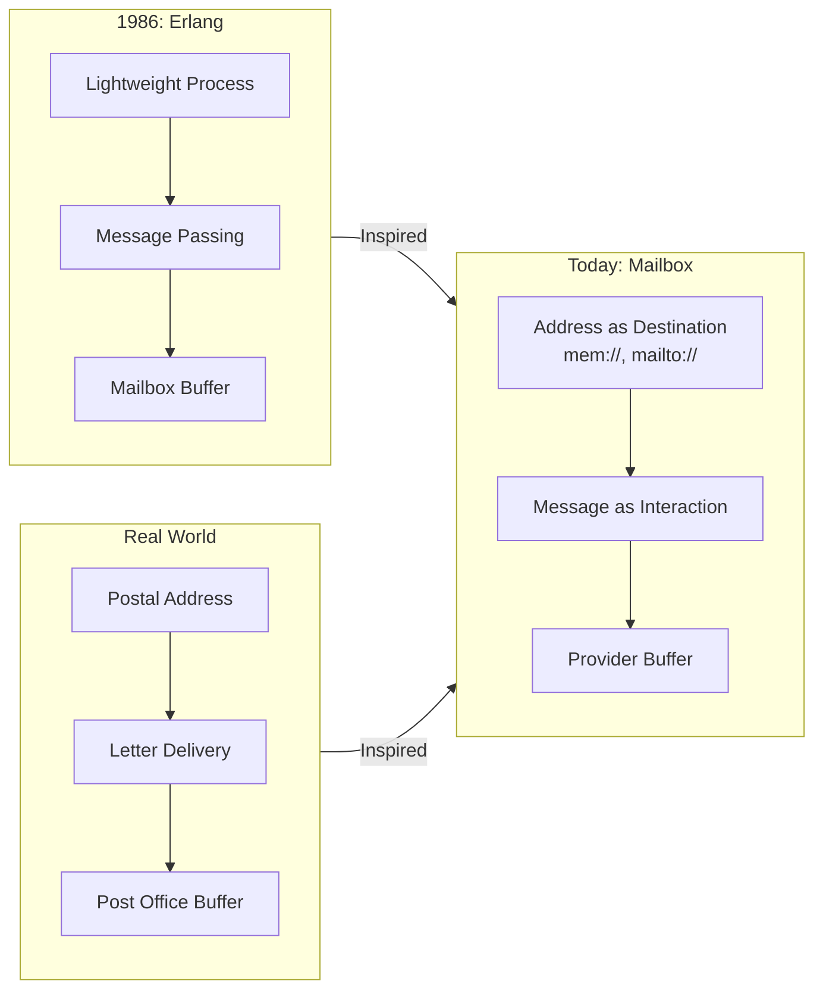

# 📮 Mailbox — Rethinking Asynchronous Programming

> A lightweight, pluggable "mailbox/queue" kernel that treats all communication as "delivering a letter to an address." An address represents a unique mailbox, which can be accessed through various transport protocols (e.g., `mem:`, `mailto:`, `slack:`) handled by different Providers.
> Use Mailbox for asynchronous communication to build fault-tolerant, distributed, human-computer collaborative systems.

[](https://www.npmjs.com/package/@mboxlabs/mailbox)
[](LICENSE-MIT)

## 🌟 Why Mailbox?

| Traditional Way                        | Mailbox Way                            |
| -------------------------------------- | -------------------------------------- |
| ❌ Shared State + Locks                | ✅ Isolated Mailboxes + Messages       |
| ❌ Callback Hell                       | ✅ Seamless `async/await` Integration  |
| ❌ Complex Human-Machine Collaboration | ✅ Human = A Mailbox Address           |
| ❌ Difficult Offline Scenarios         | ✅ Automatic Message Buffering & Retry |

### Erlang Inspiration

> _🙏 A tribute to Erlang's Actor Model_
> _"When computers were the size of rooms,
> the creators of Erlang proposed a revolutionary idea:
> **Each process has its own mailbox, communicates via messages, and crashing is not a failure but part of the design.**"_
> — Joe Armstrong, Robert Virding, Mike Williams

Mailbox is **deeply inspired by the Erlang Actor Model**, but we've made key evolutions:

| Erlang (1986)            | Mailbox (Today)                      | Why It Matters                                                                                                                                                                                             |
| ------------------------ | ------------------------------------ | ---------------------------------------------------------------------------------------------------------------------------------------------------------------------------------------------------------- |
| `Pid ! Message`          | `send({ to: 'protocol://address' })` | **Address as Identity, Protocol as Route**: The `address` part is the mailbox's unique ID. The `protocol` (e.g., `mem`, `mailto`) is for routing. The same address can be reached via different protocols. |
| In-process FIFO Mailbox  | Pluggable Providers                  | **Transport Agnostic**: Seamlessly switch between memory/email/telegram/Mastodon                                                                                                                           |
| Intra-node Communication | Cross-network, Cross-organization    | **Truly Distributed**: Humans and machines participate as equals                                                                                                                                           |

> 💡 **Our Position**:
> **Not a JavaScript clone of Erlang, but a modern expression of the Actor philosophy** —
> Using TypeScript's type safety + JavaScript's ecosystem vitality to make "address as the destination" a reality.

## 🚀 Why is Mailbox Exciting?

### 📮 What Problems Do We Solve?

| Traditional World                                     | Mailbox World                                                       |
| ----------------------------------------------------- | ------------------------------------------------------------------- |
| ❌ "Service must be online to be called"              | ✅ **Delivery is Success** — Don't care about the recipient's state |
| ❌ "Humans must respond in real-time"                 | ✅ **Human = An Address** — Process at your own pace                |
| ❌ "Cross-org collaboration requires API integration" | ✅ **Email is the API** — Zero integration cost                     |
| ❌ "Offline mobile app = Paralyzed functionality"     | ✅ **Offline is the Norm** — Messages are automatically buffered    |

### 💡 Fusing Inspirations: Erlang's Wisdom + The Real World

> _"Erlang taught us: **Message passing is the cornerstone of robust systems.**
> The real world reminds us: **The postal system has worked for 500 years because it doesn't assume the recipient is waiting at the door!**"_

Mailbox combines the two:

- **Actor's Rigor**: Each destination has an independent mailbox; messages are the only way to communicate.
- **Postal System's Inclusivity**: Unified addresses, pluggable transport protocols.



## 📪 The Mailbox Address

A Mailbox address, or **MailAddress**, is the cornerstone of the system, acting as a unique, universal identifier for any destination. It follows the [RFC 3986](https://tools.ietf.org/html/rfc3986) URI specification.

- **Format**: `protocol:user@physical_address[/logical_address]`
- **Example**: `mailto:api@myservice.com/utils/greeter`

A MailAddress is composed of three parts:

- **`protocol`**: Specifies the transport method (e.g., `mailto` for email, `mem` for in-memory bus). It tells the Mailbox which provider should handle the message.
- **`user@physical_address`**: The **Physical Mailbox Address**. This is the globally unique, protocol-independent ID for a logical mailbox or service. The same physical address can be accessed via different protocols (e.g., `mem:api@myservice.com` and `mailto:api@myservice.com` point to the same logical entity).
- **`/logical_address`** (Optional): An optional path that can be used for internal routing. For example, when used with `tool-rpc`, this can route a message to a specific tool within a larger service, allowing one physical address to serve as a unified gateway for multiple logical functions.

**Query strings and fragments are not part of an address.** An address is normalized to
`protocol://user@host/path` before it becomes a topic, so anything after `?` or `#` would be
dropped silently — `mem:sales@example.com/inbox?thread=1` and `mem:sales@example.com/inbox`
would end up sharing one queue and one delivery path, invisibly. Instead of merging two logical
addresses, Mailbox rejects such addresses at every entry point (`post()`, `subscribe()`,
`fetch()`, `status()`) with an `InvalidMailboxAddressError`. Put what distinguishes the logical
partitions in the path: `mem:sales@example.com/inbox/thread-1`.

## 🚀 Quick Start

Get a taste of Mailbox's core power in just three steps:

1. **Installation**

   ```bash
   npm install @mboxlabs/mailbox
   ```

2. **Write Code**

   ```ts
   import { Mailbox, MemoryProvider } from '@mboxlabs/mailbox'

   // 1. Create a Mailbox instance and register a memory provider
   const mailbox = new Mailbox()
   mailbox.registerProvider(new MemoryProvider())

   // 2. Start the mailbox (initializes providers)
   await mailbox.start()

   // 3. Subscribe to an address and define how to handle messages
   const subscription = mailbox.subscribe(
     'mem:service@example.com/inbox',
     (message) => {
       console.log(`Message received! From: ${message.from}`)
       console.log(`Body:`, message.body)
     }
   )

   console.log(
     "Mailbox is set up, listening on 'mem:service@example.com/inbox'..."
   )

   // 4. Post a mail to that address
   await mailbox.post({
     from: 'mem:client@example.com/user-1',
     to: 'mem:service@example.com/inbox',
     body: { text: 'Hello, Mailbox!' },
   })

   // Clean up: Unsubscribe and Stop the mailbox (releases resources)
   await subscription.unsubscribe()
   await mailbox.stop()
   ```

3. **Run It**

If you run the code above using `ts-node` or a similar tool, you'll see:

```sh
Mailbox is set up, listening on 'mem:service@example.com/inbox'...
Message received! From: mem:client@example.com/user-1
Body: { text: 'Hello, Mailbox!' }
```

This example demonstrates the basic loop of Mailbox: **Initialize -> Start -> Subscribe -> Post -> Stop**.

## 🎯 Core Features

### 1. Status Query

```ts
const status = await mailbox.status('mem:service@example.com/inbox')
console.log(`State: ${status.state}`) // 'online' | 'unknown' | 'degraded' | 'offline'
console.log(`Exists: ${status.exists}`) // does the provider know this address at all?
console.log(`Unread count: ${status.unreadCount}`) // still waiting in the queue
console.log(`In flight: ${status.inFlightCount}`) // handed out, awaiting ack/nack
console.log(`Overdue: ${status.overdueInFlightCount}`) // in flight, lease already expired, not yet reclaimed
console.log(`Oldest overdue: ${status.oldestOverdueMs}ms`)
console.log(`Subscribers: ${status.subscriberCount}`)
console.log(`Last activity: ${status.lastActivityTime}`) // ISO 8601, or null
```

`unreadCount` only counts messages still waiting in the queue. A message taken with
`manualAck: true` has left the queue but is not yet processed — it is reported separately as
`inFlightCount`, and it returns to the queue once its lease expires. Reclaiming that lease is
**lazy** (there is no background timer; the next `manualAck` fetch of that topic sweeps expired
leases back), so a wedged consumer can park expired leases in-flight indefinitely. That is why
`overdueInFlightCount` is reported separately: `inFlightCount` is legitimately non-zero on a
healthy system, so **alert on `overdueInFlightCount`**, not on it.

`state` describes the provider's view **of that address**. An address the provider has never
seen (never posted to, never subscribed, no recorded activity) reports `state: 'unknown'` and
`exists: false` — reporting `online` + 0 for it would make a dashboard unable to tell
"this address does not exist" from "this address is idle". A drained but real address stays
`online`; so does an address that only has subscribers. `exists` is left unset when the provider
cannot answer status queries at all: "I cannot ask" is not "it does not exist".
`lastActivityTime` is `null` when there is no record — never `undefined`, which would vanish
entirely from `JSON.stringify`.

Diagnostics pages and tests usually want the whole picture at once. Call `status()` with no
arguments (or `snapshot()`, same view) to get every topic of every registered provider:

```ts
const snap = await mailbox.status()
console.log(snap.state) // 'online' | 'degraded' | 'unknown'
console.log(snap.addressCount) // topics known across the registered providers
console.log(snap.unreadCount, snap.inFlightCount)
for (const entry of snap.addresses) {
  console.log(entry.canonicalId, entry.state, entry.unreadCount)
}
```

`addresses` is sorted by `canonicalId` so snapshots are reproducible. Providers whose messages do
not live locally (AMQP / SQS style brokers) cannot enumerate their topics; they are listed in
`unsupportedProviders` and the snapshot degrades to `state: 'degraded'` instead of pretending the
queues are empty.

### 2. Receiving mail: `subscribe` vs `fetch`

Four verbs, four APIs — use these words consistently:

| Verb      | API                           | Who acts                                                     |
| --------- | ----------------------------- | ------------------------------------------------------------ |
| publish   | `post()` / `send()`           | the producer writes a message to an address                  |
| subscribe | `subscribe()`                 | the consumer registers a callback; it runs when mail arrives |
| fetch     | `fetch()`                     | the consumer asks for the next message itself                |
| peek      | `fetch(addr, { peek: true })` | an observer looks at the queue without consuming anything    |

Publishing only writes. A published message goes to **one** of the two receiving paths,
decided at the moment `post()` runs:

| State of the address when `post()` runs | Where the message goes                                                           |
| --------------------------------------- | -------------------------------------------------------------------------------- |
| At least one active subscriber          | handed to every subscriber's callback; **not** queued, so `fetch()` gets nothing |
| No subscriber                           | queued; `fetch()` gets it, subscribers get nothing                               |

The two paths are mutually exclusive per message: a message that was handed to a subscriber
can never be fetched, and a message that is already queued is never replayed to a subscriber
that appears later.

Firing both paths would make `unreadCount` grow forever (subscribers never call `fetch`) and
would hand an already-processed message to the next `fetch()` after an unsubscribe.

The one exception is a failing callback: if it throws a retriable error and nobody handled
the message, it goes back to the queue, where `fetch()` can pick it up — see below.

```ts
// subscribe: the callback runs when mail arrives
const sub = mailbox.subscribe(addr, (message) => {
  console.log(message.body)
})

// fetch: you ask for the next message yourself
const message = await mailbox.fetch(addr)

// peek: read-only audit of the queue — never dequeue, never in-flight, never bumps activity
const pending = await mailbox.fetch(addr, { peek: true, limit: 5 })
```

`peek` returns **copies** of the queued messages as an array (`[]` when the queue is idle), and it
changes nothing: `unreadCount` and `inFlightCount` stay put, `lastActivityTime` is not refreshed,
and mutating what you got back cannot touch the queue. Before `peek` existed, the closest trick
was `fetch(addr, { manualAck: true })` without acking — that parks the message in-flight (requeued
after the 30s ack timeout by default), which is not read-only and distorts what real consumers
see. `peek` never lists messages another consumer is holding; those only show up as
`inFlightCount`. Combining `peek` with `manualAck` throws (`InvalidFetchOptionsError`), and a
provider that cannot do read-only snapshots throws `UnsupportedCapabilityError` rather than
silently falling back to a consuming fetch.

### 3. When a subscriber fails

The callback's error decides what happens to the message:

```ts
mailbox.subscribe(addr, async (message) => {
  throw Object.assign(new Error('upstream down'), { isRetriable: true }) // → back to the queue
})

mailbox.subscribe(addr, async (message) => {
  throw new Error('bad payload') // → dropped, so one bad message is not retried forever
})
```

Retriable means `error.isRetriable === true`, or `error.code` in `503 / 504 / ECONNRESET /
ETIMEDOUT`. A retriable failure requeues the message (visible in `unreadCount`, retrievable
with `fetch()`); anything else is **given up** — on the shipped providers that means discarded
(archived only if you turn on a dead-letter queue), and on a queue / transport provider the
kernel first tells the transport to stop redelivering it (`nack(message, false)`). The [Rust
port](https://github.com/mboxlabs/mailbox.rust) makes the same call on the `Result<()>` that a
callback returns.

One address can have several subscribers, and subscribing is a **broadcast**: one message
becomes one _delivery_ per subscriber, and each delivery settles on its own
(`deliveryId = subscriptionId + messageId`). That distinction decides what happens when
subscribers disagree — A succeeds, B throws a retriable error:

| Broadcast outcome                | What the mailbox does                                                                        |
| -------------------------------- | -------------------------------------------------------------------------------------------- |
| Some delivery succeeded          | message stays handled — **not** requeued; failing deliveries go to `_onDeliveryDeadLettered` |
| Every delivery failed, retriable | message goes back to the head of the queue, `fetch()` picks it up (one copy)                 |
| Every delivery failed, fatal     | discarded, so one bad message is not retried forever                                         |

Requeueing a message that somebody already handled would hand the same side effect to a
`fetch()` consumer a second time, which is why partial failure is settled per delivery instead.

Settlement happens once every delivery has finished, retry chain included. `post()` resolves at
dispatch, not at settlement, so `status()` right after `post()` says nothing about the outcome —
use `_onDeliveryDeadLettered(message, failedDeliveries)` (subclass `MemoryProvider`) to observe
or dead-letter what was dropped.

**What the kernel does not decide.** It decides _whether_ a delivery is handed back
(`_nack(message, requeue)` + `shouldRequeueAfterBroadcast`). It does not decide how many times a
message is redelivered, where it goes back in the queue, or what is left behind once it is given
up — those belong to the provider. Consequences worth knowing:

- On a queue / transport provider (`broadcastDeliveries = false`, the base-class default) a
  non-retriable failure now emits the give-up signal: `nack(message, false)`. Without it a real
  broker redelivers the same poison message forever after its visibility timeout.
- A provider that does not implement `_nack` at all cannot receive either decision: the base
  class warns once instead of dropping the decision silently.
- Nothing lands in a dead-letter queue unless you wire one. `MemoryProvider#enableDeadLetterQueue()`
  is the shipped reference wiring; the hook is called **after** the disposition (`nack`) so a
  message never sits in the queue and the DLQ at the same time. A hook that throws (or rejects)
  is logged and cannot swallow the disposition.
- The pull side (`fetch()` consumers settling with their own `ack` / `nack`, invisible to the kernel)
  follows the same two rules: one `fetch()` is one disposition (a second `ack` / `nack` on the same
  handle is a no-op), and a disposition that did not land — the message was already requeued by the
  stale sweep, dropped by `clear()`, or belongs to another consumer — is not a give-up. One give-up
  therefore leaves exactly one dead-letter record, so a compensation script cannot compensate twice.
- Each delivery carries `headers['mbx-attempt']` — the attempt number **inside that delivery's
  retry chain** — plus `mbx-max-attempts` when a retry policy is set, and `DeliveryResult`
  carries `attempts` and an `error` summary, so a DLQ record can answer "why did it die, and how
  many times did we try". `mbx-attempt` is **not** a redelivery counter: it restarts at `'1'`
  once the message goes back to the queue. The counter that accumulates across requeues is
  `headers['mbx-round']` ("which delivery round is this") — whoever hands the message to a
  consumer bumps it, and the copy the kernel puts back into the queue carries it. That is the
  number a provider reads to implement its own `maxReceiveCount` cap: the kernel deliberately
  leaves the cap to providers, and `mbx-round` is the input it owes them.
- Queue bookkeeping keys on **which copy of a letter**, not on `messageId`. `id` is a name the
  sender chose and it may repeat (content-hash ids, a sender retrying its own send, a hostile
  sender colliding on purpose). Every `post()` mints one `headers['mbx-send-id']`, and queueing,
  the in-flight table, requeue dedup and `ack` / `nack` all account per copy. Keying those on `id`
  lets one letter overwrite another's slot: a requeue gets dismissed as a duplicate and the message
  ends up nowhere — not queued, not dead-lettered — and an id reused at one address can suppress a
  requeue at a different one. Headers the system owns (`mbx-send-id`, `mbx-round`, `mbx-attempt`,
  `mbx-max-attempts`, `mbx-sent-at`, `mbx-dead-letter*`) are stripped from `post()` input: trusting
  them would let the sender pick its own redelivery cap or stamp live mail as a dead-letter record.
  Content-level idempotency is a separate, explicit, *loud* policy at the send edge — the kernel
  never drops a letter silently.

> The [Python](https://github.com/mboxlabs/mailbox.py) and [Rust](https://github.com/mboxlabs/mailbox.rust)
> ports settle a broadcast per delivery in exactly this way. Each port's README
> ("Subscriber Failures and Retry") lists its own API names; the rule above is the specification
> they all follow.

### 4. Retrying a failed subscriber (opt-in)

By default a retriable failure only goes back to the queue: nothing calls the callback again,
and a `fetch()` consumer decides what happens next. Opt into automatic redelivery when you
want the library to retry the callback itself:

```ts
import { MemoryProvider } from '@mboxlabs/mailbox'

const provider = new MemoryProvider({ maxAttempts: 3, baseDelay: 1_000 }) // milliseconds
mailbox.registerProvider(provider)
```

|                   | Default (`retry` omitted)            | With a policy                                |
| ----------------- | ------------------------------------ | -------------------------------------------- |
| Retriable failure | requeued once; `fetch()` picks it up | callback re-invoked with exponential backoff |
| Attempts          | 1                                    | `maxAttempts`, first try included            |
| Budget exhausted  | —                                    | requeued when no delivery succeeded          |

Three rules keep this safe:

- **Only the failing subscriber is retried.** Subscribing is a broadcast; re-broadcasting
  would run the side effects of the subscribers that already succeeded a second time.
- **A message is never queued twice.** `requeue()` skips a message that is already queued or
  in flight, so N failing subscribers leave exactly one copy in the queue.
- **A handled message is never requeued.** If any delivery of the broadcast succeeded, the
  failing ones are dead-lettered (`_onDeliveryDeadLettered`) instead of putting the whole
  message back; requeue is reserved for "every subscriber failed".

Retry is opt-in because AMQP / SQS style transports already redeliver and ship dead-letter
queues — retrying on top of them would double-deliver. Providers that own redelivery should
leave it off. `provider.setRetryPolicy(null)` returns to the default, `_onRetryExhausted` is
where a subclass can alert (exhaustion is _not_ a give-up: the message still goes back to the
queue), and `_onDeliveryDeadLettered` is where failed deliveries that will not be requeued can be
persisted.

Turning "give up" into something you can act on, without writing your own hook:

```ts
const provider = MemoryProvider.createIsolated()
provider.enableDeadLetterQueue() // default suffix '_dlq'; pass { suffix: '.dlq' } to change it
mailbox.registerProvider(provider)

// every delivery that was dropped instead of requeued is archived to <topic>_dlq:
const dead = await mailbox.fetch(
  provider.deadLetterTopic('mem://sales@bus/inbox')!
)
// dead.headers['mbx-dead-letter-reason']   -> 'fatal' | 'retriable' | 'consumer-nack'
// dead.headers['mbx-dead-letter-attempts'] -> '3'  // attempts in the chain that died
// dead.headers['mbx-dead-letter-round']    -> '1'  // which delivery round this message was on
// dead.headers['mbx-dead-letter-error']    -> 'Error: bad payload'
// dead.headers['mbx-dead-letter-topic']    -> the queue it came from
// dead.headers['mbx-dead-letter-depth']    -> '1'  // how deep in the dead-letter chain this is
```

A dead-letter topic can itself be given up on — a compensation worker that crashes is the common
case. The chain is capped: `enableDeadLetterQueue({ maxNesting })` defaults to **one** level, so a
record fetched out of `X_dlq` and given up again is **parked** in `X_dlq` (marked
`mbx-dead-letter-terminal: 'true'`, logged CRITICAL) instead of opening `X_dlq_dlq`, then
`X_dlq_dlq_dlq`, forever. Parking is not losing: the record stays in the queue, visible to
`peek` / `status`, and a worker that `fetch`es it and `ack`s it drains it. Pass a bigger
`maxNesting` to get a real chain; `Number.POSITIVE_INFINITY` is the explicit "no limit" exit.
`deadLetterTopic()` tells you where the give-up actually lands — at the cap it returns the topic
itself rather than a deeper address that would never be written.

The suffix is appended to the **end of the path**, and it must already be in canonical form. A
suffix that address canonicalization would rewrite — non-ASCII, ``" < > ` { }``, `.` / `..` path
segments — is rejected by `enableDeadLetterQueue()`: otherwise the dead letter lands in a topic
no address can name it (or, worse, in somebody else's live queue). Use the percent-encoded
spelling (`_死信` → `_%E6%AD%BB%E4%BF%A1`) or plain ASCII.

It is opt-in because a dead-letter queue is an operational decision, not a kernel default: it
writes a second copy of the message into a topic somebody has to consume. Off, the default stays
what it always was — dropped. It covers both ways a message gets given up: a subscriber's failed
delivery, and a `fetch()` consumer calling `nack(false)`. Archiving is keyed to **the queue the
message was actually taken out of**, not to `message.to`: an archived copy keeps its original `to`
(so it can be replayed into the business queue), and `mbx-dead-letter-topic` names the hop it came
from. The pull side disposes **first** and
archives afterwards, and one `fetch()` settles only once: repeating `nack(false)` does not add a
second record, and `nack(false)` after an `ack()` does not dead-letter a message that succeeded.

The same policy — same retriable check, same backoff formula, same "never queue twice" rule — is
implemented in the [Python](https://github.com/mboxlabs/mailbox.py) and
[Rust](https://github.com/mboxlabs/mailbox.rust) ports; their READMEs show the constructor spelling
for each language.

The policy math is exported as well — `RetryPolicy`, `isRetriableError`, `nextRetryDelay`,
`AttemptLedger` — so another package (an RPC transport, say) can reuse the same retriable check
and backoff instead of writing its own. So is the delivery bookkeeping: `DeliveryResult`,
`shouldRequeueAfterBroadcast`.

### 5. Acknowledgement Timeouts

`fetch(address, { manualAck: true })` moves the message to the in-flight state. Without a
timeout a crashed consumer leaks the message forever, so an unacknowledged message is
requeued after `DEFAULT_ACK_TIMEOUT` (30s) by default:

```ts
import { DEFAULT_ACK_TIMEOUT } from '@mboxlabs/mailbox'

await mailbox.fetch(addr, { manualAck: true }) // 30s lease for *this* fetch
await mailbox.fetch(addr, { manualAck: true, ackTimeout: 5_000 }) // custom lease
await mailbox.fetch(addr, { manualAck: true, ackTimeout: 0 }) // this lease never expires
```

`ackTimeout` is the length of **the lease this fetch takes out**, fixed at handoff time and
recorded on the lease — it is not the sweep threshold. Another consumer's `ackTimeout` can neither
shorten a lease that has not expired (a 1ms fetch cannot steal someone else's in-flight message)
nor stretch one that has (an expired lease is reclaimed no matter how long the next caller asks
for), and it cannot void a `0` / `null` lease. Whether a lease has expired is decided by the lease
itself, at the moment it was handed out — otherwise any consumer's single fetch could cancel
another consumer's lease. What an expired-but-unreclaimed lease costs you is visibility, which is
what `overdueInFlightCount` (§2) exists to remove.

Reclaiming is triggered by the next `manualAck` fetch. That is fine for a polling consumer, but if
the last consumer crashes — nobody fetches that address again — the expired lease sits in-flight
forever. For that case there is an explicit, idempotent entry point:

```ts
const r = await mailbox.recover(addr)  // { reclaimed: 1, supported: true }
const all = await mailbox.recover()    // every enumerable address: { reclaimed, byAddress, unreachableProviders }
```

`recover()` only touches **expired** leases: letters still inside their lease, and `ackTimeout: 0`
/ `null` leases, are left alone. Calling it twice is harmless. A provider with no lease concept
(push-style, or a broker that owns visibility timeouts itself, like AMQP / SQS) answers
`supported: false` — do not read `reclaimed: 0` as "all clear". If you would rather have it happen
on a clock, the sweeper is opt-in (default **off**, `unref()`ed so it cannot keep the process alive,
cleared by `stop()`):

```ts
new MemoryProvider(null, new MemoryEventBus(), { leaseSweepIntervalMs: 1000 })
```

The [Python](https://github.com/mboxlabs/mailbox.py) and
[Rust](https://github.com/mboxlabs/mailbox.rust) ports keep the same three states: default timeout,
custom timeout, never expires.

### 6. Settlement Safety Nets (timeouts, races, provider contracts)

A broadcast is only settled once **every** delivery of it settles — that is what makes the
per-delivery requeue rule in §3 work, and it is also where the hazards hide. Four safety nets:

- **A stuck callback cannot make a message invisible.** Every delivery _attempt_ is watched by
  `provider.deliverySettleTimeout` (default `DEFAULT_DELIVERY_SETTLE_TIMEOUT` = 30s). When it
  fires the attempt is settled as `cancelled`: the message falls back to `fetch()` (or the
  dead-letter hook) and a warning is logged. The watchdog covers one attempt only — a backoff
  wait is never counted — so it cannot cut a healthy retry chain short. Setting
  `provider.deliverySettleTimeout = 0` opts out: you then own the lifecycle, and a callback that
  never returns keeps its message out of every queue.
- **`unsubscribe()` and `stop()` never prejudge a running callback.** Only deliveries sitting in a
  retry backoff are cancelled. A callback that is still running settles on its own; declaring it
  failed would make the broadcast look like "nobody succeeded" and hand the same side effect to a
  `fetch()` consumer a second time.
- **Concurrent deliveries of the same `id` settle independently.** `post({ id })` accepts
  caller-supplied ids, so two in-flight deliveries to one subscriber never share settlement
  bookkeeping. Dedup still applies where it belongs: a message already queued or in flight is
  never queued twice.
- **A missing `_nack` is not silently fatal.** Every disposition (`requeue = true` back to the
  queue, `requeue = false` give up) goes through `nack()`. A provider that never implements
  `_nack` receives none of them, and the message stays wherever the transport left it; the base
  class warns once per provider instead of pretending the decision was carried out.
- **The `message` handed to `_ack` / `_nack` is a copy, not the one you sent.** Each delivery
  attempt gets its own shallow copy stamped with `mbx-attempt` / `mbx-round` (plus
  `mbx-max-attempts` under a retry policy). The callback, `_ack` and `_nack` of one attempt share
  that single object, but it is never the object `_send` saw, and a retry chain makes a new copy
  per attempt. So a provider must **not** key bookkeeping by object identity
  (`Map<MailMessage, handle>`, `WeakMap`, `set.has(message)`): a miss throws nothing and warns
  nothing, it just silently skips the ack and a real broker redelivers the message forever. Key by
  `message.id`, by your own broker handle, or by `DeliveryResult.deliveryId` for delivery-level
  identity (copies change, delivery ids do not). Shallow means: `headers` is a fresh object,
  `body` / `meta` / `from` / `to` are still shared references. One escape hatch worth knowing — a
  broadcast barrier that never recorded a delivery copy (deliveries not routed through the base
  entry point, a second barrier for a concurrent same-`id` broadcast, or the copy table hitting
  `MAX_SETTLED_COPIES`) falls back to the unstamped `_send` object, so treat a missing counter as
  possible. Details: `wiki/delivery-semantics.md` §7.3.

If you implement your own **broadcast** provider (`broadcastDeliveries = true`), `_send` must
attach the settlement barrier — synchronously, before any `await`:

```ts
protected async _send(message: MailMessage): Promise<void> {
  const deliveries = this.bus.publish(topic, message) // one promise per delivery
  this._trackBroadcastSettlement(message, deliveries)
}
```

A provider that forgets it does not lose messages silently: the base class falls back to a
whole-message requeue and warns you. Producer-style providers that build a message themselves and
hand it to a local subscriber must use `_deliverToLocalSubscription(subscriptionId, message)`,
otherwise that delivery is never accounted for.

### 7. Accessing Providers

You can gracefully access registered providers via the `providers` getter or `getProvider` method:

```ts
// Get all providers (returns a ReadonlyMap)
const allProviders = mailbox.providers
if (allProviders.has('mem')) {
  console.log('Memory provider is registered')
}

// Get a specific provider
// protocol can be "mem" or "mem:"
const provider = mailbox.getProvider('mem')

// Get provider or throw error if not found
const slackProvider = mailbox.getProvider('slack', true)
```

## 🔄 Lifecycle Management

For robust production systems, explicit lifecycle management is crucial:

- **`mailbox.start()`**: Parallelly initializes all registered providers. Use this to pre-warm connections (e.g., Redis, RabbitMQ) and validate configurations before processing traffic.
- **`mailbox.stop()`**: Parallelly closes all providers. It automatically:
  - Cancels all active subscriptions.
  - Releases underlying resources (TCP connections, file handles).
  - Ensures a graceful shutdown of your communication layer.

  It never deletes messages: a provider that is closed and started again still sees the backlog
  left behind. Use `mailbox.stop({ purge: true })` to drop it.

## 🧵 Instance isolation and state reset (`mem:` provider)

`MemoryProvider` simulates a broker on an in-memory event bus. By default every
`MemoryProvider` shares one process-wide bus, so all `Mailbox` instances in the process see the
same `mem:` queues and subscription tables, and that state outlives `stop()`. This is
intentional — it is what lets two `Mailbox` instances talk to each other — but it means you have
to choose the boundary explicitly when you want independence (host + plugin, kernel + provider,
or tests that must not leak into each other):

```ts
// 1. Private bus — no one else in the process can see its queues or subscriptions.
const isolated = MemoryProvider.createIsolated()

// 2. Named namespace — shared within a scope, invisible across scopes.
const tenant = MemoryProvider.forScope('tenant-a')

// 3. Bring your own bus — e.g. two Mailboxes that are meant to share one "server".
const shared = new MemoryProvider(null, new MemoryEventBus())
```

Reset state without tearing subscriptions down:

```ts
await mailbox.clear() // drop every provider's backlog (queued + in-flight)
await mailbox.stop({ purge: true }) // close subscriptions, then drop the backlog
provider.bus.clear('mem://inbox@example.com') // one topic only; returns how many messages were dropped
```

Caveats worth knowing:

- `clear()` drops messages, never subscriptions. Closing a channel is `unsubscribe()` / `stop()`'s job.
- On the default bus, `clear()` clears the whole `mem:` namespace of the process — that is what a
  shared "server" means. Use `createIsolated()` / `forScope()` when that is not what you want.
- One provider instance must not be registered on two Mailboxes: subscriptions live on the provider,
  so `stop()` on one unsubscribes the other. The library warns once when it sees this.
- The scope registry is never garbage-collected: a scope name generated per run (timestamp, random
  id) pins its bus for the lifetime of the process. Use `createIsolated()` for throwaway state.

## 📦 Ecosystem

| Package                                                                    | Description                                                                                  |
| -------------------------------------------------------------------------- | -------------------------------------------------------------------------------------------- |
| [`@mboxlabs/mailbox`](https://github.com/mboxlabs/mailbox.js)              | The core mailbox system                                                                      |
| [`@mboxlabs/mailbox-input`](https://github.com/mboxlabs/mailbox-input.js)  | Input Provider: An abstract class for human-computer interaction                             |
| [`@mboxlabs/mailbox-email`](https://github.com/mboxlabs/mailbox-email.js)  | Mailbox Provider: Email (SMTP, IMAP/POP3)                                                    |
| [`mboxlabs-mailbox` (crates.io)](https://github.com/mboxlabs/mailbox.rust) | Rust port — `cargo add mboxlabs-mailbox` (v0.1.0, also builds to WASM)                       |
| [`mailbox.py`](https://github.com/mboxlabs/mailbox.py)                     | Python port — `pip install git+https://github.com/mboxlabs/mailbox.py.git` (not on PyPI yet) |

> **One specification, three implementations.** The address format, subscribe-versus-fetch,
> per-delivery settlement, opt-in retry and ack timeouts are specified once — in this README — and
> implemented identically in TypeScript, Python and Rust. Change the semantics and all three suites
> (`vitest` / `pytest` / `cargo test`) have to agree.

## 📚 Learn More

- [API Reference](docs/)

## 🤝 Contributing

See [CONTRIBUTING.md](CONTRIBUTING.md) — we welcome all contributors!

> **Remember**: In the world of Mailbox, **every mailbox is an independent universe, and messages are the couriers that travel through spacetime** 🌌
