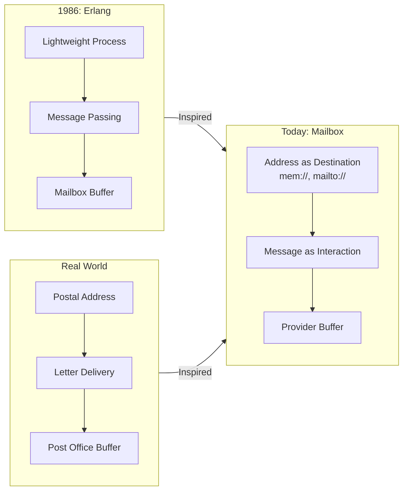

**@mboxlabs/mailbox**

***

# 📮 Mailbox — Rethinking Asynchronous Programming

> A lightweight, pluggable "mailbox/queue" kernel that treats all communication as "delivering a letter to an address." An address represents a unique mailbox, which can be accessed through various transport protocols (e.g., `mem:`, `mailto:`, `slack:`) handled by different Providers.
> Use Mailbox for asynchronous communication to build fault-tolerant, distributed, human-computer collaborative systems.

[](https://www.npmjs.com/package/@mboxlabs/mailbox)
[](LICENSE-MIT)

## 🌟 Why Mailbox?

| Traditional Way | Mailbox Way |
|---|---|
| ❌ Shared State + Locks | ✅ Isolated Mailboxes + Messages |
| ❌ Callback Hell | ✅ Seamless `async/await` Integration |
| ❌ Complex Human-Machine Collaboration | ✅ Human = A Mailbox Address |
| ❌ Difficult Offline Scenarios | ✅ Automatic Message Buffering & Retry |

### Erlang Inspiration

> _🙏 A tribute to Erlang's Actor Model_
> _"When computers were the size of rooms,
> the creators of Erlang proposed a revolutionary idea:
> **Each process has its own mailbox, communicates via messages, and crashing is not a failure but part of the design.**"_
> — Joe Armstrong, Robert Virding, Mike Williams

Mailbox is **deeply inspired by the Erlang Actor Model**, but we've made key evolutions:

| Erlang (1986) | Mailbox (Today) | Why It Matters |
|---|---|---|
| `Pid ! Message` | `send({ to: 'protocol://address' })` | **Address as Identity, Protocol as Route**: The `address` part is the mailbox's unique ID. The `protocol` (e.g., `mem`, `mailto`) is for routing. The same address can be reached via different protocols. |
| In-process FIFO Mailbox | Pluggable Providers | **Transport Agnostic**: Seamlessly switch between memory/email/telegram/Mastodon |
| Intra-node Communication | Cross-network, Cross-organization | **Truly Distributed**: Humans and machines participate as equals |

> 💡 **Our Position**:
> **Not a JavaScript clone of Erlang, but a modern expression of the Actor philosophy** —
> Using TypeScript's type safety + JavaScript's ecosystem vitality to make "address as the destination" a reality.

## 🚀 Why is Mailbox Exciting?

### 📮 What Problems Do We Solve?

| Traditional World | Mailbox World |
|---|---|
| ❌ "Service must be online to be called" | ✅ **Delivery is Success** — Don't care about the recipient's state |
| ❌ "Humans must respond in real-time" | ✅ **Human = An Address** — Process at your own pace |
| ❌ "Cross-org collaboration requires API integration" | ✅ **Email is the API** — Zero integration cost |
| ❌ "Offline mobile app = Paralyzed functionality" | ✅ **Offline is the Norm** — Messages are automatically buffered |

### 💡 Fusing Inspirations: Erlang's Wisdom + The Real World

> _"Erlang taught us: **Message passing is the cornerstone of robust systems.**
> The real world reminds us: **The postal system has worked for 500 years because it doesn't assume the recipient is waiting at the door!**"_

Mailbox combines the two:

- **Actor's Rigor**: Each destination has an independent mailbox; messages are the only way to communicate.
- **Postal System's Inclusivity**: Unified addresses, pluggable transport protocols.



## 📪 The Mailbox Address

A Mailbox address, or **MailAddress**, is the cornerstone of the system, acting as a unique, universal identifier for any destination. It follows the [RFC 3986](https://tools.ietf.org/html/rfc3986) URI specification.

- **Format**: `protocol:user@physical_address[/logical_address]`
- **Example**: `mailto:api@myservice.com/utils/greeter`

A MailAddress is composed of three parts:

- **`protocol`**: Specifies the transport method (e.g., `mailto` for email, `mem` for in-memory bus). It tells the Mailbox which provider should handle the message.
- **`user@physical_address`**: The **Physical Mailbox Address**. This is the globally unique, protocol-independent ID for a logical mailbox or service. The same physical address can be accessed via different protocols (e.g., `mem:api@myservice.com` and `mailto:api@myservice.com` point to the same logical entity).
- **`/logical_address`** (Optional): An optional path that can be used for internal routing. For example, when used with `tool-rpc`, this can route a message to a specific tool within a larger service, allowing one physical address to serve as a unified gateway for multiple logical functions.

## 🚀 Quick Start

Get a taste of Mailbox's core power in just three steps:

1. **Installation**

    ```bash
    npm install @mboxlabs/mailbox
    ```

2. **Write Code**

    ```ts
    import { Mailbox, MemoryProvider } from '@mboxlabs/mailbox';

    // 1. Create a Mailbox instance and register a memory provider
    const mailbox = new Mailbox();
    mailbox.registerProvider(new MemoryProvider());

    // 2. Start the mailbox (initializes providers)
    await mailbox.start();

    // 3. Subscribe to an address and define how to handle messages
    const subscription = mailbox.subscribe('mem:service@example.com/inbox', message => {
      console.log(`Message received! From: ${message.from}`);
      console.log(`Body:`, message.body);
    });

    console.log("Mailbox is set up, listening on 'mem:service@example.com/inbox'...");

    // 4. Post a mail to that address
    await mailbox.post({
      from: 'mem:client@example.com/user-1',
      to: 'mem:service@example.com/inbox',
      body: { text: 'Hello, Mailbox!' },
    });

    // Clean up: Unsubscribe and Stop the mailbox (releases resources)
    await subscription.unsubscribe();
    await mailbox.stop();
    ```

3. **Run It**

If you run the code above using `ts-node` or a similar tool, you'll see:

```sh
Mailbox is set up, listening on 'mem:service@example.com/inbox'...
Message received! From: mem:client@example.com/user-1
Body: { text: 'Hello, Mailbox!' }
```

This example demonstrates the basic loop of Mailbox: **Initialize -> Start -> Subscribe -> Post -> Stop**.

## 🎯 Core Features

### 1. Status Query

```ts
const status = await mailbox.status('mem:service@example.com/inbox');
console.log(`State: ${status.state}`);
console.log(`Unread count: ${status.unreadCount}`);   // still waiting in the queue
console.log(`In flight: ${status.inFlightCount}`);    // handed out, awaiting ack/nack
console.log(`Subscribers: ${status.subscriberCount}`);
```

`unreadCount` only counts messages still waiting in the queue. A message taken with
`manualAck: true` has left the queue but is not yet processed — it is reported separately as
`inFlightCount`, and it returns to the queue if it is never acknowledged.

### 2. Receiving mail: `subscribe` vs `fetch`

Three verbs, three APIs — use these words consistently:

| Verb | API | Who acts |
| --- | --- | --- |
| publish | `post()` / `send()` | the producer writes a message to an address |
| subscribe | `subscribe()` | the consumer registers a callback; it runs when mail arrives |
| fetch | `fetch()` | the consumer asks for the next message itself |

Publishing only writes. A published message goes to **one** of the two receiving paths,
decided at the moment `post()` runs:

| State of the address when `post()` runs | Where the message goes |
| --- | --- |
| At least one active subscriber | handed to every subscriber's callback; **not** queued, so `fetch()` gets nothing |
| No subscriber | queued; `fetch()` gets it, subscribers get nothing |

The two paths are mutually exclusive per message: a message that was handed to a subscriber
can never be fetched, and a message that is already queued is never replayed to a subscriber
that appears later.

Firing both paths would make `unreadCount` grow forever (subscribers never call `fetch`) and
would hand an already-processed message to the next `fetch()` after an unsubscribe.

The one exception is a failing callback: if it throws a retriable error, the message goes back
to the queue, where `fetch()` can pick it up — see below.

```ts
// subscribe: the callback runs when mail arrives
const sub = mailbox.subscribe(addr, (message) => {
  console.log(message.body);
});

// fetch: you ask for the next message yourself
const message = await mailbox.fetch(addr);
```

### 3. When a subscriber fails

The callback's error decides what happens to the message:

```ts
mailbox.subscribe(addr, async (message) => {
  throw Object.assign(new Error('upstream down'), { isRetriable: true }); // → back to the queue
});

mailbox.subscribe(addr, async (message) => {
  throw new Error('bad payload'); // → dropped, so one bad message is not retried forever
});
```

Retriable means `error.isRetriable === true`, or `error.code` in `503 / 504 / ECONNRESET /
ETIMEDOUT`. A retriable failure requeues the message (visible in `unreadCount`, retrievable
with `fetch()`); anything else is discarded. The Python and Rust ports behave the same way —
in Rust the callback returns `Result<()>` and `MailboxError::is_retriable()` makes the call.

### 4. Retrying a failed subscriber (opt-in)

By default a retriable failure only goes back to the queue: nothing calls the callback again,
and a `fetch()` consumer decides what happens next. Opt into automatic redelivery when you
want the library to retry the callback itself:

```ts
import { MemoryProvider } from '@mboxlabs/mailbox';

const provider = new MemoryProvider({ maxAttempts: 3, baseDelay: 1_000 }); // milliseconds
mailbox.registerProvider(provider);
```

| | Default (`retry` omitted) | With a policy |
|---|---|---|
| Retriable failure | requeued once; `fetch()` picks it up | callback re-invoked with exponential backoff |
| Attempts | 1 | `maxAttempts`, first try included |
| Budget exhausted | — | message requeued, `fetch()` picks it up |

Two rules keep this safe:

- **Only the failing subscriber is retried.** Subscribing is a broadcast; re-broadcasting
  would run the side effects of the subscribers that already succeeded a second time.
- **A message is never queued twice.** `requeue()` skips a message that is already queued or
  in flight, so N failing subscribers leave exactly one copy in the queue.

Retry is opt-in because AMQP / SQS style transports already redeliver and ship dead-letter
queues — retrying on top of them would double-deliver. Providers that own redelivery should
leave it off. `provider.setRetryPolicy(null)` returns to the default, and the
`_onRetryExhausted` hook is where a subclass can dead-letter or alert.

The same policy exists in Python (`RetryPolicy(max_attempts=3, base_delay=1.0)`, seconds) and
Rust (`MemoryProvider::with_retry(Some(RetryPolicy::new(3, Duration::from_millis(1000))))`).

The policy math is exported as well — `RetryPolicy`, `isRetriableError`, `nextRetryDelay`,
`AttemptLedger` — so another package (an RPC transport, say) can reuse the same retriable check
and backoff instead of writing its own.

### 5. Acknowledgement Timeouts

`fetch(address, { manualAck: true })` moves the message to the in-flight state. Without a
timeout a crashed consumer leaks the message forever, so an unacknowledged message is
requeued after `DEFAULT_ACK_TIMEOUT` (30s) by default:

```ts
import { DEFAULT_ACK_TIMEOUT } from '@mboxlabs/mailbox';

await mailbox.fetch(addr, { manualAck: true });                    // 30s default
await mailbox.fetch(addr, { manualAck: true, ackTimeout: 5_000 }); // custom
await mailbox.fetch(addr, { manualAck: true, ackTimeout: 0 });     // never requeue
```

The same three-state semantics applies to the Python (`ack_timeout`, `0` = never requeue)
and Rust (`ack_timeout: Option<Duration>`, `Some(Duration::ZERO)` = never requeue) ports.

### 6. Accessing Providers

You can gracefully access registered providers via the `providers` getter or `getProvider` method:

```ts
// Get all providers (returns a ReadonlyMap)
const allProviders = mailbox.providers;
if (allProviders.has('mem')) {
  console.log('Memory provider is registered');
}

// Get a specific provider
// protocol can be "mem" or "mem:"
const provider = mailbox.getProvider('mem');

// Get provider or throw error if not found
const slackProvider = mailbox.getProvider('slack', true);
```

## 🔄 Lifecycle Management

For robust production systems, explicit lifecycle management is crucial:

- **`mailbox.start()`**: Parallelly initializes all registered providers. Use this to pre-warm connections (e.g., Redis, RabbitMQ) and validate configurations before processing traffic.
- **`mailbox.stop()`**: Parallelly closes all providers. It automatically:
  - Cancels all active subscriptions.
  - Releases underlying resources (TCP connections, file handles).
  - Ensures a graceful shutdown of your communication layer.

## 📦 Ecosystem

| Package | Description |
|---|---|
| [`@mboxlabs/mailbox`](https://github.com/mboxlabs/mailbox.js) | The core mailbox system |
| [`@mboxlabs/mailbox-input`](https://github.com/mboxlabs/mailbox-input.js) | Input Provider: An abstract class for human-computer interaction |
| [`@mboxlabs/mailbox-email`](https://github.com/mboxlabs/mailbox-email.js) | Mailbox Provider: Email (SMTP, IMAP/POP3) |

## 📚 Learn More

- [Erlang Inspiration Deep Dive](erlang-inspiration.md)
- [5 Real-world Scenario Examples](examples.md)
- [API Reference](_media/docs)

## 🤝 Contributing

See [CONTRIBUTING.md](_media/CONTRIBUTING.md) — we welcome all contributors!

> **Remember**: In the world of Mailbox, **every mailbox is an independent universe, and messages are the couriers that travel through spacetime** 🌌
